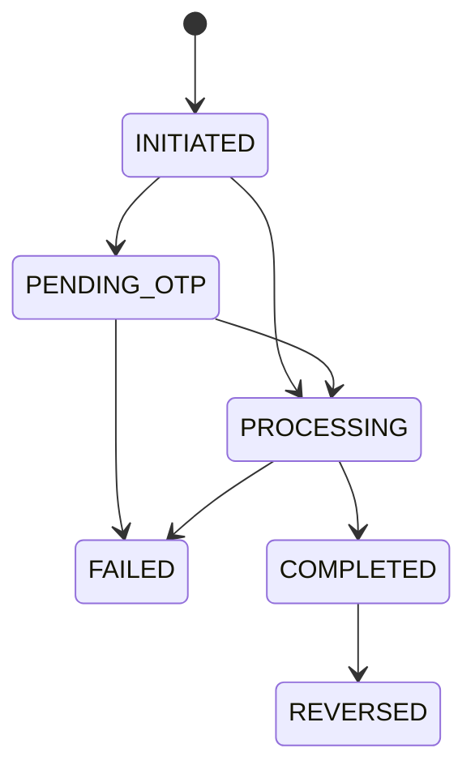

# Simple Banking App — Web Desktop

Ứng dụng ngân hàng trực tuyến chạy trên trình duyệt desktop, cho phép người dùng quản lý tài khoản, nạp/rút tiền, chuyển khoản nội bộ an toàn, tra cứu lịch sử giao dịch, cập nhật hồ sơ cá nhân kèm lịch sử phiên bản (`account_history`), và hỗ trợ quản trị viên (`ADMIN`) quản lý người dùng (khóa/mở khóa, xóa mềm), quản lý tài khoản (`ACTIVE`/`FROZEN`/`CLOSED`, hạng `STANDARD`/`VIP`, phong tỏa số dư `holdAmount`), giám sát giao dịch toàn hệ thống, xem nhật ký kiểm toán và thực hiện hoàn tiền (`REVERSAL`). Dự án tuân thủ nguyên tắc K.I.S.S, đảm bảo tính toàn vẹn dữ liệu và bảo mật bằng Database Transaction, Pessimistic Locking (`SELECT ... FOR UPDATE`), chống Deadlock, bảng **`idempotency_keys`** (lưu mã băm SHA-256, bản chụp kết quả và hạn dùng 24h) kết hợp **Auto-Retry an toàn phía Frontend**, **Sổ cái kép chỉ-ghi-thêm (`ledger_entries`)**, **Vòng đời giao dịch (State Machine 3 Pha)**, **Phân quyền RBAC (`CUSTOMER` / `ADMIN`)**, **Nhật ký kiểm toán tự động chỉ-ghi-thêm (`audit_logs`)**, **Hạn mức giao dịch theo lần & ngày Việt Nam**, **Số dư khả dụng (`balance − hold_amount`)** và **Xóa mềm (`Soft Delete`)**.

## 1. Overview & Tech Stack
- **Backend:** NestJS, TypeScript, TypeORM (Migrations & Entity Subscribers), PostgreSQL, `@nestjs/schedule` (Cron quét giao dịch treo & dọn khóa Idempotency hết hạn), Node.js `AsyncLocalStorage`, Passport JWT, Bcrypt, Class-Validator, Swagger.
- **Frontend:** Next.js (App Router — Client Components), ReactJS, Zustand, Tailwind CSS, Axios (kèm cơ chế Idempotent Auto-Retry & `useRef` In-Flight Guard).
- **Infrastructure & Testing:** Docker, Docker Compose, Jest & Supertest (8 bộ E2E Test Suites với 66 bài kiểm thử tích hợp trên DB test tách biệt).

## 2. Architecture
Hệ thống phân tầng rõ ràng theo kiến trúc module của NestJS: `Middleware (AsyncLocalStorage) -> Guard (JwtAuthGuard, RolesGuard) -> Interceptor (AuditInterceptor) -> Controller -> Service -> TypeORM Repository / EntityManager / Subscriber -> PostgreSQL`.
- Sơ đồ tuần tự (Auth + Login Audit, Luồng giao dịch 3 Pha kèm kiểm tra Trạng thái/Hạn mức/Khả dụng & Idempotency Snapshot, Hoàn tiền `REVERSAL`, Khóa/Mở khóa User, và Xóa mềm User + Đóng tài khoản): xem tại [`docs/sequence_diagrams.md`](docs/sequence_diagrams.md).
- Ghi chép quyết định kiến trúc (ADR-001 → ADR-018): xem tại [`docs/ADR.md`](docs/ADR.md).
- Báo cáo thực nghiệm Concurrency & Locking (Module 1):
  - [`docs/concurrency/1.1-race-condition.md`](docs/concurrency/1.1-race-condition.md) — Tái hiện lỗi Race Condition (Lost Update).
  - [`docs/concurrency/1.3-lock-comparison.md`](docs/concurrency/1.3-lock-comparison.md) — Benchmark so sánh Pessimistic Locking và Optimistic Locking.
  - [`docs/concurrency/1.4-deadlock.md`](docs/concurrency/1.4-deadlock.md) — Phòng ngừa & Xử lý Deadlock khi chuyển khoản hai chiều A↔B.

## 3. Environment Variables
Sao chép file môi trường mẫu trước khi chạy:
```bash
# Cho Docker Compose ở thư mục gốc
cp .env.example .env

# Cho phát triển local & chạy test trong thư mục backend
cp backend/.env.example backend/.env
cp backend/.env.test.example backend/.env.test
```

## 4. Chạy dự án bằng Docker (Khuyên dùng)
Chỉ cần một lệnh duy nhất từ thư mục gốc:
```bash
docker compose up --build
```
Khi khởi động, container `backend` sẽ tự động thực hiện tuần tự:
1. Chạy TypeORM Migrations (`npm run migration:run:prod` — tạo bảng, backfill sổ cái, gắn trigger bất biến cho `ledger_entries`, `audit_logs`, `account_history`, nâng cấp schema State Machine / Reversal, tạo bảng `idempotency_keys`, chuẩn hóa enum `users.role` và bổ sung cột hạn mức / trạng thái tài khoản / xóa mềm).
2. Chạy Seed dữ liệu mẫu nếu `SEED_ON_START=true` (tạo 1 `ADMIN`, 3 `CUSTOMER` với hạng `STANDARD` / `VIP`, giao dịch mẫu và đồng bộ bút toán sổ cái mà không sinh bản ghi audit rác).
3. Khởi động NestJS API server ở cổng `3000`.

Các địa chỉ truy cập:
- **Frontend UI:** http://localhost:3001
- **Backend API:** http://localhost:3000/api
- **Swagger Docs:** http://localhost:3000/api/docs

## 5. Local Development & Quản lý Migration
Nếu muốn chạy Backend và Frontend trực tiếp trên máy host:
```bash
# 1. Khởi chạy PostgreSQL cho môi trường dev (cổng 5432)
docker compose up -d postgres

# 2. Chạy Migration & Seed tại thư mục backend
cd backend
npm install
npm run migration:run
npm run seed
npm run start:dev

# 3. Khởi chạy Frontend ở một cửa sổ terminal khác
cd frontend
npm install
npm run dev
```

Các lệnh quản lý schema với TypeORM Migration (trong thư mục `backend/`):
- Chạy migration mới nhất: `npm run migration:run`
- Hoàn tác (rollback) 1 migration gần nhất: `npm run migration:revert`
- Sinh migration mới khi sửa Entity: `npm run migration:generate -- src/database/migrations/<TenMigration>`

## 6. Chạy Kiểm thử Tự động (66 E2E Tests trên DB Test riêng)
Dự án bố trí container `postgres-test` chạy riêng ở cổng `5433` (sử dụng `tmpfs` trên RAM) để việc chạy test **không bao giờ chạm vào dữ liệu dev**:
```bash
# 1. Bật container database test (cổng 5433)
docker compose --profile test up -d postgres-test

# 2. Tạo file .env.test (nếu chưa có) và chạy toàn bộ E2E Test
cd backend
cp .env.test.example .env.test
npm run test:e2e
```
Bộ test bao gồm 8 test suites (66 bài kiểm thử tích hợp):
- `test/app.e2e-spec.ts` (1 test): Smoke test luồng Đăng ký → Đăng nhập → Xem số dư → Nạp tiền (`DEPOSIT` / `COMPLETED`).
- `test/concurrency.e2e-spec.ts` (3 tests — Bài 7.2 + Kiểm tra bất biến Q1′–Q5):
  - **T1:** 20 request rút `100,000đ` đồng thời trên số dư `1,000,000đ` (5 vòng) → luôn đúng `10 × 201 COMPLETED`, `10 × 422 FAILED`, số dư `0.00`.
  - **T2:** Chuyển khoản hai chiều A→B và B→A đồng thời (5 vòng) → không deadlock/500, bảo toàn tổng số dư `A + B`.
  - **T3:** 5 request đồng thời dùng chung 1 `Idempotency-Key` (5 vòng) → tất cả phản hồi trong `{201, 200, 202}`, chỉ tạo đúng 1 giao dịch `COMPLETED` và 2 bút toán trong DB.
- `test/ledger.e2e-spec.ts` (5 tests — Bài 3.1 & Bài 7.3):
  - **L1 – L3, R1 – R2:** Chặn `UPDATE`/`DELETE` trên `ledger_entries`; khớp số dư với tổng bút toán; kiểm tra rollback Pha B không để lại bút toán mồ côi.
- `test/state-machine-reversal.e2e-spec.ts` (10 tests — Bài 3.2 & Bài 5.3):
  - **ST, ST2, F1, F2, P1, P2, V1 – V4:** Duyệt 36 cặp chuyển trạng thái; ghi nhận `FAILED`; quét giao dịch treo `sweepStuckTransactions()`; hoàn tiền `REVERSAL` và chống hoàn tiền hai lần.
- `test/idempotency.e2e-spec.ts` (10 tests — Bài 2.1):
  - **I1 – I10:** Kiểm chứng gửi lặp 5 lần tuần tự, trùng khóa khác nội dung (`409`), 5 request đồng thời cùng khóa, replay lỗi `FAILED`, khóa hết hạn, dọn dẹp `deleteExpiredKeys()`, cô lập khóa theo `user_id`, và bảo toàn bản chụp `COMPLETED`.
- `test/rbac-admin-audit.e2e-spec.ts` (14 tests — Bài 3.3 & Bài 4.1):
  - **RB1 – RB4, AD1 – AD4, AU1 – AU6:** Kiểm chứng ma trận quyền RBAC, hiệu lực tức thì khi đổi role/khóa user, các API `/api/admin/*`, Subscriber/Interceptor ghi `audit_logs` cùng transaction và bất biến Q6–Q7.
- `test/limits-account-status.e2e-spec.ts` (13 tests — Bài 5.1 & Bài 5.2):
  - **L1 – L7:** Kiểm chứng hạn mức mỗi lần (`30.000.000,01đ` bị từ chối `LIMIT_PER_TRANSACTION_EXCEEDED`), hạn mức lũy kế ngày (`5 × 9.9M` thành công, lần 6 bị từ chối `LIMIT_PER_DAY_EXCEEDED` dù nhỏ, đúng `500.000đ` còn lại thành công), nâng hạng `VIP` có hiệu lực ngay, biên múi giờ Việt Nam (`23:59` hôm qua vs `00:01` hôm nay), 10 giao dịch đồng thời không vượt hạn mức ngày, miễn hạn mức cho `DEPOSIT`/`REVERSAL`, và khối `limits` trên `/api/accounts/me`.
  - **A1 – A6:** Kiểm chứng 4 mã lỗi trạng thái tài khoản (`SOURCE_ACCOUNT_FROZEN`, `SOURCE_ACCOUNT_CLOSED`, `DESTINATION_ACCOUNT_FROZEN`, `DESTINATION_ACCOUNT_CLOSED`) đều ghi nhận `FAILED`, luật đóng tài khoản `CLOSED`, số dư khả dụng (`balance − hold_amount`) và tranh chấp đồng thời giữa đặt hold với rút tiền, 3 ràng buộc `CHECK` mức DB, Audit `ACCOUNT_UPDATED`, và hoàn tiền khi tài khoản bị đóng băng.
- `test/soft-delete-profile-history.e2e-spec.ts` (10 tests — Bài 3.4):
  - **S1 – S5:** Kiểm chứng xóa mềm người dùng có số dư `0` (`DELETE /api/admin/users/:id` → `204`), thu hồi phiên `401` tức thì trên cả token cũ, ẩn khỏi danh sách mặc định và hiện khi `includeDeleted=true`, giữ nguyên `counterpartyAccountNumber` trong lịch sử của đối tác, giữ chỗ email đã xóa (`409`), và rollback nguyên tử cùng Audit `USER_SOFT_DELETED`.
  - **H1 – H5:** Kiểm chứng đổi số điện thoại 2 lần lưu 2 bản chụp cũ vào `account_history` theo đúng `version`, đổi email yêu cầu `currentPassword` (sai trả `400`), rollback nguyên tử khi lỗi giữa chừng, phân quyền xem lịch sử hồ sơ, chặn sửa/xóa `account_history` bằng Trigger, và bất biến Q8–Q10.

## 7. Concurrency, Locking & Deadlock (Module 1)
1. **Chống Lost Update / Âm quỹ (Bài 1.1 & 1.2):** Khóa dòng tài khoản bằng `SELECT ... FOR UPDATE OF "account"` kết hợp `UPDATE ... WHERE status = 'ACTIVE' AND deleted_at IS NULL AND (balance - hold_amount) >= :amount RETURNING balance` và `SET LOCAL lock_timeout = '5s'`.
2. **Phòng ngừa & Xử lý Deadlock (Bài 1.4):** Tải và khóa các tài khoản theo thứ tự cố định `ORDER BY account.id ASC`, kết hợp vòng lặp `executeWithDeadlockRetry` (tối đa 3 lần khi gặp mã `40P01`).
3. **Chạy Script bắn tải:**
   ```bash
   node scripts/concurrency/withdraw-load.mjs
   node scripts/concurrency/transfer-ab-ba.mjs
   ```

## 8. Sổ cái kép — Double-entry Ledger (Module 3A)
Mọi biến động số dư ở Pha B đều được ghi thành các bút toán bất biến trong bảng `ledger_entries` (`id BIGSERIAL`, `account_id`, `transaction_id`, `type DEBIT | CREDIT`, `amount > 0`, `balance_after >= 0` lấy từ `UPDATE ... RETURNING balance`) trong cùng một Database Transaction và được bảo vệ bởi Trigger `trg_ledger_entries_immutable`.

## 9. Vòng đời giao dịch (State Machine) & Hoàn tiền (`REVERSAL` — Module 3B)

### 9.1. Sơ đồ trạng thái & Bảng cạnh hợp lệ
Mọi thay đổi cột `status` trên bảng `transactions` bắt buộc phải đi qua hàm `transition()` với câu lệnh đóng dấu có điều kiện `UPDATE transactions SET status = :to, updated_at = now() WHERE id = :id AND status = :from`:



### 9.2. Luồng thực thi 3 Pha & Bảng mã lỗi (`FAILURE_CODE_MAP`)
- **Pha A (Tạo phiếu & Khóa):** Kiểm tra đầu vào (400/404), đăng ký khóa `idempotency_keys` (`IN_PROGRESS`) bằng `INSERT ... ON CONFLICT DO NOTHING` → `INSERT` phiếu `INITIATED` → `transition(INITIATED → PROCESSING)` → gắn `transaction_id` vào dòng khóa → `COMMIT`.
- **Pha B (Xử lý tiền, Kiểm tra Trạng thái/Hạn mức/Khả dụng, Sổ cái & Lưu Snapshot):** Khóa tài khoản `FOR UPDATE` → Kiểm tra tuần tự: (1) `user.status`, (2) `account.status === 'ACTIVE'`, (3) hạn mức lần & ngày giờ VN, (4) số dư khả dụng (`balance - hold_amount >= amount`) → Trừ/cộng tiền (`RETURNING balance`) → Ghi bút toán `ledger_entries` → `transition(PROCESSING → COMPLETED)` → cập nhật `idempotency_keys` sang `COMPLETED` kèm bản chụp `response_body` (`201`) → `COMMIT`.
- **Pha C (Ghi nhận `FAILED`):** Khi Pha B lỗi và đã `ROLLBACK` hoàn toàn (số dư và sổ cái không đổi), mở transaction ngắn mới gọi `transition(PROCESSING → FAILED, { failureCode })` và cập nhật `idempotency_keys` sang `FAILED` kèm bản chụp lỗi → `COMMIT`.

| `failure_code` | HTTP Status | Thông báo lỗi trả về Client |
| :--- | :---: | :--- |
| `INSUFFICIENT_BALANCE` | `422` | Không đủ số dư khả dụng |
| `DESTINATION_UNAVAILABLE` | `422` | Tài khoản đích đang bị khóa, không thể nhận tiền |
| `SOURCE_ACCOUNT_FROZEN` | `422` | Tài khoản nguồn đang bị đóng băng, không thể thực hiện giao dịch |
| `SOURCE_ACCOUNT_CLOSED` | `422` | Tài khoản nguồn đã đóng, không thể thực hiện giao dịch |
| `DESTINATION_ACCOUNT_FROZEN` | `422` | Tài khoản đích đang bị đóng băng, không thể nhận tiền |
| `DESTINATION_ACCOUNT_CLOSED` | `422` | Tài khoản đích đã đóng, không thể nhận tiền |
| `LIMIT_PER_TRANSACTION_EXCEEDED` | `422` | Số tiền vượt quá hạn mức mỗi giao dịch của hạng tài khoản (kèm số còn lại hôm nay) |
| `LIMIT_PER_DAY_EXCEEDED` | `422` | Số tiền vượt quá hạn mức giao dịch trong ngày (kèm số còn lại hôm nay) |
| `AMOUNT_OVERFLOW` | `422` | Số dư tài khoản vượt quá giới hạn cho phép |
| `REVERSAL_INSUFFICIENT_BALANCE` | `422` | Tài khoản nhận không đủ số dư để thực hiện hoàn tiền |
| `SERVER_BUSY` | `503` | Hệ thống đang bận, vui lòng thử lại |
| `TIMEOUT` | `503` | Giao dịch bị quá thời gian xử lý, vui lòng thử lại |
| `INTERNAL_ERROR` | `500` | Lỗi hệ thống khi thực hiện giao dịch |

### 9.3. Bộ 5 Truy vấn Bất biến Sổ cái & Hoàn tiền (Q1′, Q2, Q3, Q4, Q5)
Tất cả 5 truy vấn dưới đây đều phải trả về **`(0 rows)`**:

```bash
# Q1′ — Bút toán đúng theo loại và trạng thái
docker compose exec postgres psql -U root -d simple_bank -c "
SELECT t.id, t.type, t.status
FROM transactions t
LEFT JOIN ledger_entries le ON le.transaction_id = t.id
GROUP BY t.id, t.type, t.status, t.amount, t.original_transaction_id
HAVING CASE
  WHEN t.status NOT IN ('COMPLETED', 'REVERSED') THEN COUNT(le.id) <> 0
  WHEN t.type = 'TRANSFER' THEN
       COUNT(le.id) <> 2
    OR COALESCE(SUM(le.amount) FILTER (WHERE le.type = 'DEBIT'), 0)  <> t.amount
    OR COALESCE(SUM(le.amount) FILTER (WHERE le.type = 'CREDIT'), 0) <> t.amount
  WHEN t.type = 'DEPOSIT' THEN
       COUNT(le.id) <> 1
    OR COALESCE(SUM(le.amount) FILTER (WHERE le.type = 'CREDIT'), 0) <> t.amount
  WHEN t.type = 'WITHDRAW' THEN
       COUNT(le.id) <> 1
    OR COALESCE(SUM(le.amount) FILTER (WHERE le.type = 'DEBIT'), 0) <> t.amount
  WHEN t.type = 'REVERSAL' THEN
       COUNT(le.id) <> (SELECT COUNT(*) FROM ledger_entries o WHERE o.transaction_id = t.original_transaction_id)
END;
"

# Q2 — Số dư hiển thị (accounts.balance) khớp tổng bút toán
docker compose exec postgres psql -U root -d simple_bank -c "
SELECT a.account_number, a.balance,
       COALESCE(SUM(CASE le.type WHEN 'CREDIT' THEN le.amount ELSE -le.amount END), 0) AS computed
FROM accounts a
LEFT JOIN ledger_entries le ON le.account_id = a.id
GROUP BY a.id, a.account_number, a.balance
HAVING a.balance <> COALESCE(SUM(CASE le.type WHEN 'CREDIT' THEN le.amount ELSE -le.amount END), 0);
"

# Q3 — Cột balance_after khớp số dư cộng dồn theo thứ tự id
docker compose exec postgres psql -U root -d simple_bank -c "
SELECT x.id, x.account_id, x.balance_after, x.running
FROM (
  SELECT le.id, le.account_id, le.balance_after,
         SUM(CASE le.type WHEN 'CREDIT' THEN le.amount ELSE -le.amount END)
           OVER (PARTITION BY le.account_id ORDER BY le.id) AS running
  FROM ledger_entries le
) x
WHERE x.balance_after <> x.running;
"

# Q4 — Mỗi cặp (giao dịch gốc, hoàn tiền COMPLETED) triệt tiêu nhau (net = 0)
docker compose exec postgres psql -U root -d simple_bank -c "
SELECT o.id AS original_id, le.account_id,
       SUM(CASE le.type WHEN 'CREDIT' THEN le.amount ELSE -le.amount END) AS net
FROM transactions o
JOIN transactions r ON r.original_transaction_id = o.id AND r.type = 'REVERSAL' AND r.status = 'COMPLETED'
JOIN ledger_entries le ON le.transaction_id IN (o.id, r.id)
GROUP BY o.id, le.account_id
HAVING SUM(CASE le.type WHEN 'CREDIT' THEN le.amount ELSE -le.amount END) <> 0;
"

# Q5 — Trạng thái REVERSED và REVERSAL COMPLETED nhất quán 1-1
docker compose exec postgres psql -U root -d simple_bank -c "
SELECT o.id FROM transactions o
WHERE o.status = 'REVERSED'
  AND (SELECT COUNT(*) FROM transactions r
       WHERE r.original_transaction_id = o.id AND r.type = 'REVERSAL' AND r.status = 'COMPLETED') <> 1
UNION ALL
SELECT r.id FROM transactions r
WHERE r.type = 'REVERSAL' AND r.status = 'COMPLETED'
  AND NOT EXISTS (SELECT 1 FROM transactions o WHERE o.id = r.original_transaction_id AND o.status = 'REVERSED');
"
```

## 10. Cơ chế Chống Trùng Lặp Giao Dịch (`idempotency_keys`) & Frontend Auto-Retry (Module 2)
- Lưu khóa chống trùng trong bảng **`idempotency_keys`** (`UNIQUE (user_id, idempotency_key)`), kiểm tra `request_hash` (SHA-256), lưu bản chụp `response_status` & `response_body`, và tự động dọn khóa hết hạn (`TTL = 24 giờ`) mỗi giờ qua `@Cron(CronExpression.EVERY_HOUR)`.
- Hàm dùng chung `submitIdempotentTransaction()` (`frontend/src/services/api.ts`) đặt `timeout = 10s`, tự động retry tối đa `MAX_RETRIES = 3` lần (`1s → 2s → 4s`) với **cùng `Idempotency-Key`** khi mất mạng/timeout hoặc nhận `202 Accepted`, kết hợp cờ `inFlightRef = useRef(false)`.

## 11. Phân quyền theo Vai trò (RBAC) & Admin API (Module 4A — Bài 4.1)

| Endpoint | Không có Token | `CUSTOMER` (Active) | `ADMIN` (Active) | User bị `locked` / Xóa mềm |
| :--- | :---: | :---: | :---: | :---: |
| `GET /api/accounts/me`, `GET\|PATCH /api/users/me`, `GET /api/users/me/profile-history`, `POST /api/transactions/transfer\|deposit\|withdraw`, `GET /api/transactions` | `401` | ✅ (Của mình) | ✅ (Của mình) | ❌ `403` (`locked`) / `401` (xóa mềm) |
| `GET /api/accounts/:accountNumber` | `401` | ✅ `200` (Của mình)<br>❌ `403` (Người khác) | ✅ `200` (Mọi TK)<br>`404` (Không tồn tại / Đã xóa) | ❌ `403` / `401` |
| `POST /api/transactions/:id/reverse` | `401` | ❌ `403` | ✅ `201 / 200 / 202` | ❌ `403` / `401` |
| `GET /api/admin/users`, `PATCH /api/admin/users/:id/status`, `DELETE /api/admin/users/:id`, `GET /api/admin/users/:id/profile-history` | `401` | ❌ `403` | ✅ `200 / 204` | ❌ `403` / `401` |
| `PATCH /api/admin/accounts/:accountNumber` | `401` | ❌ `403` | ✅ `200` | ❌ `403` / `401` |
| `GET /api/admin/transactions`, `GET /api/admin/audit-logs` | `401` | ❌ `403` | ✅ `200` | ❌ `403` / `401` |

## 12. Nhật ký Kiểm toán Tự động (`audit_logs` — Module 4A Bài 3.3)
Bảng `audit_logs` (`id BIGSERIAL`, chỉ-ghi-thêm bằng Trigger `trg_audit_logs_immutable`) tự động ghi nhận:
- Qua `UserAuditSubscriber` & `AccountAuditSubscriber` (cùng Database Transaction qua `event.manager`): `USER_STATUS_CHANGED`, `USER_UPDATED`, `USER_SOFT_DELETED`, `ACCOUNT_UPDATED`.
- Qua `AuditInterceptor` + `@Audit()`: `AUTH_LOGIN_SUCCESS`, `AUTH_LOGIN_FAILED`, `TRANSACTION_REVERSED`.

Hai truy vấn kiểm toán **Q6** và **Q7** (kỳ vọng **`0 rows`**):
```bash
docker compose exec postgres psql -U root -d simple_bank -c "
SELECT id, action FROM audit_logs
WHERE before_data::text ILIKE '%password%' OR after_data::text ILIKE '%password%';

SELECT id FROM audit_logs
WHERE action = 'USER_STATUS_CHANGED'
  AND (before_data IS NULL OR after_data IS NULL
       OR before_data->>'status' IS NOT DISTINCT FROM after_data->>'status');
"
```

## 13. Hạn mức giao dịch, Trạng thái tài khoản & Số dư khả dụng (Module 5 — Bài 5.1 & 5.2)

### 13.1. Bảng các ngưỡng Hạn mức theo Hạng tài khoản (`tier`)
Hạn mức áp dụng cho các giao dịch làm tiền đi ra khỏi tài khoản nguồn (**`TRANSFER`** và **`WITHDRAW`**; miễn áp dụng cho `DEPOSIT` và `REVERSAL`), được kiểm tra ở **Bước 3 của Pha B dưới khóa dòng `SELECT ... FOR UPDATE`**:

| Hạng tài khoản (`accounts.tier`) | Hạn mức tối đa mỗi giao dịch (`perTransaction`) | Hạn mức lũy kế tối đa mỗi ngày (`perDay`) | Cách tính "Đã dùng hôm nay" (`usedToday`) |
| :--- | :---: | :---: | :--- |
| **`STANDARD`** (Mặc định) | `30,000,000.00 VND` | `50,000,000.00 VND` | Tổng `amount` của các giao dịch `TRANSFER` / `WITHDRAW` có `status = 'COMPLETED'` trong ngày hiện tại theo giờ Việt Nam (`now() AT TIME ZONE 'Asia/Ho_Chi_Minh'`). Không tính `FAILED`, `REVERSED`, `DEPOSIT`, `REVERSAL`. |
| **`VIP`** | `100,000,000.00 VND` | `200,000,000.00 VND` | Như trên. Khi Admin đổi `tier` qua `PATCH /api/admin/accounts/:accountNumber`, hạn mức mới có hiệu lực ngay lập tức. |

### 13.2. Trạng thái tài khoản (`ACTIVE / FROZEN / CLOSED`) & Số dư khả dụng (`balance − hold_amount`)
- **Trạng thái tài khoản (`accounts.status`):** Chỉ tài khoản **`ACTIVE`** mới được phép giao dịch (cả chiều đi lẫn chiều đến, kể cả hoàn tiền `REVERSAL`). Giao dịch chạm vào tài khoản `FROZEN` hoặc `CLOSED` bị từ chối ở Pha B (`422`) và được Pha C ghi nhận trạng thái **`FAILED`** kèm mã lỗi rõ ràng (`SOURCE_ACCOUNT_FROZEN`, `SOURCE_ACCOUNT_CLOSED`, `DESTINATION_ACCOUNT_FROZEN`, `DESTINATION_ACCOUNT_CLOSED`).
- **Luật chuyển trạng thái (`PATCH /api/admin/accounts/:accountNumber`):** `ACTIVE ↔ FROZEN` tự do; `CLOSED` là trạng thái kết thúc (không thể mở lại → `409`); chỉ được đóng tài khoản sang `CLOSED` khi `balance = 0`, `hold_amount = 0` và không có giao dịch đang xử lý dở (`INITIATED / PENDING_OTP / PROCESSING`).
- **Số dư khả dụng (`availableBalance = balance − holdAmount`):** Được bảo vệ bởi 3 lớp: kiểm tra `BigInt` ở Pha B, điều kiện `WHERE (balance - hold_amount) >= :amount` ngay trong câu lệnh `UPDATE`, và 3 ràng buộc `CHECK` mức PostgreSQL (`balance >= 0`, `hold_amount >= 0`, `hold_amount <= balance`).

## 14. Xóa mềm (`Soft Delete`) & Lịch sử phiên bản hồ sơ (`account_history` — Bài 3.4)

### 14.1. Xóa mềm người dùng & tài khoản (`DELETE /api/admin/users/:id`)
- Chỉ `ADMIN` được phép xóa mềm người dùng có vai trò `CUSTOMER` khi tài khoản thỏa mãn `balance = 0`, `hold_amount = 0` và không có giao dịch đang dở.
- Trong cùng một Database Transaction: chuyển `account.status = 'CLOSED'`, đánh dấu `deleted_at` cho cả `Account` và `User`, ghi Audit `ACCOUNT_UPDATED` & `USER_SOFT_DELETED`.
- **Thu hồi phiên tức thì & Bảo toàn lịch sử đối tác:** Ngay sau khi xóa mềm, mọi JWT token cũ của user đó bị `JwtStrategy` từ chối `401`; đăng nhập lại trả `401`; đăng ký lại cùng email trả `409`; biến mất khỏi `/api/admin/users` mặc định (hiện lại khi `?includeDeleted=true`); nhưng lịch sử giao dịch của những người từng giao dịch với tài khoản đó vẫn hiển thị nguyên vẹn `counterpartyAccountNumber` (nhờ `.withDeleted()` khi JOIN).

### 14.2. Cập nhật hồ sơ & Lịch sử phiên bản (`PATCH /api/users/me` & `account_history`)
- Người dùng cập nhật `fullName`, `email` (bắt buộc kèm `currentPassword`, sai trả `400 Bad Request`), `phone` (định dạng Việt Nam `^(\+84|0)\d{9}$` hoặc `null`).
- Khi có ít nhất 1 trường thực sự thay đổi, trong cùng một Database Transaction dưới khóa `FOR UPDATE`: hệ thống **chèn bản chụp giá trị cũ vào bảng `account_history`** (chỉ-ghi-thêm bằng Trigger `trg_account_history_immutable`) với `version = profile_version` hiện tại trước, sau đó mới cập nhật giá trị mới và tăng `profile_version + 1`.
- Tra cứu lịch sử phiên bản hồ sơ qua `GET /api/users/me/profile-history` (cá nhân) hoặc `GET /api/admin/users/:id/profile-history` (Admin).

### 14.3. Bộ 3 Truy vấn Bất biến của Module 5 (Q8, Q9, Q10)
Cả 3 truy vấn dưới đây đều phải trả về **`(0 rows)`**:
```bash
docker compose exec postgres psql -U root -d simple_bank -c "
-- Q8: Số dư và hold luôn hợp lệ
SELECT id FROM accounts WHERE balance < 0 OR hold_amount < 0 OR hold_amount > balance;

-- Q9: Tài khoản đã xóa mềm luôn CLOSED, không còn tiền hay hold
SELECT id FROM accounts
WHERE deleted_at IS NOT NULL AND (status <> 'CLOSED' OR balance <> 0 OR hold_amount <> 0);

-- Q10: User và tài khoản luôn bị xóa mềm cùng nhau
SELECT u.id FROM users u JOIN accounts a ON a.user_id = u.id
WHERE (u.deleted_at IS NULL) <> (a.deleted_at IS NULL);
"
```

## 15. Seed Data & Tài khoản Demo
Script seed (`npm run seed`) là **idempotent** (dùng `withDeleted: true`, không sinh bản ghi audit rác), tạo sẵn 1 `ADMIN` và 3 `CUSTOMER`:
- **System Admin (`ADMIN` / `active` / `STANDARD`):** `admin@bank.local` / `Password@123` — STK: `1000000000` — Số dư: `0.00 VND`.
- **Customer A (`CUSTOMER` / `active` / `STANDARD`):** `user1@bank.local` / `Password@123` — STK: `1000000001` — Số dư: `5,000,000.00 VND` (Hạn mức: `30M/lần`, `50M/ngày`).
- **Customer B (`CUSTOMER` / `active` / `VIP`):** `user2@bank.local` / `Password@123` — STK: `1000000002` — Số dư: `2,000,000.00 VND` (Hạn mức: `100M/lần`, `200M/ngày`).
- **Customer C (`CUSTOMER` / `locked` / `STANDARD`):** `user3@bank.local` / `Password@123` — STK: `1000000003` — Số dư: `1,000,000.00 VND`.

## 16. API Endpoints
| Method | Endpoint | Quyền hạn | Mô tả |
| :--- | :--- | :---: | :--- |
| `POST` | `/api/auth/register` | Public | Đăng ký người dùng mới (`CUSTOMER`, `STANDARD`, `ACTIVE`, `balance = 0.00`) |
| `POST` | `/api/auth/login` | Public | Đăng nhập nhận JWT Access Token (tự động ghi Audit Log `AUTH_LOGIN_SUCCESS` / `FAILED`) |
| `GET` | `/api/users/me` | `CUSTOMER`, `ADMIN` | Xem hồ sơ cá nhân hiện tại (`fullName`, `email`, `phone`, `profileVersion`) |
| `PATCH` | `/api/users/me` | `CUSTOMER`, `ADMIN` | Cập nhật hồ sơ cá nhân (đổi email cần `currentPassword`; lưu bản cũ vào `account_history`) |
| `GET` | `/api/users/me/profile-history` | `CUSTOMER`, `ADMIN` | Xem lịch sử các phiên bản hồ sơ cũ của bản thân (phân trang, mới nhất trước) |
| `GET` | `/api/accounts/me` | `CUSTOMER`, `ADMIN` | Xem tài khoản của bản thân (`balance`, `holdAmount`, `availableBalance`, `status`, `tier`, `limits`) |
| `GET` | `/api/accounts/:accountNumber` | `CUSTOMER` (của mình), `ADMIN` (tất cả) | Tra cứu tài khoản theo STK (`CUSTOMER` xem của người khác → `403`) |
| `POST` | `/api/transactions/deposit` | `CUSTOMER`, `ADMIN` | Nạp tiền vào tài khoản `ACTIVE` của bản thân (miễn hạn mức; Header `Idempotency-Key`) |
| `POST` | `/api/transactions/withdraw` | `CUSTOMER`, `ADMIN` | Rút tiền từ tài khoản `ACTIVE` (kiểm tra hạn mức & khả dụng; Header `Idempotency-Key`) |
| `POST` | `/api/transactions/transfer` | `CUSTOMER`, `ADMIN` | Chuyển khoản nội bộ (kiểm tra `ACTIVE`, hạn mức & khả dụng; Header `Idempotency-Key`) |
| `POST` | `/api/transactions/:id/reverse` | Chỉ `ADMIN` | Hoàn tiền giao dịch `COMPLETED` bằng giao dịch `REVERSAL` mới (yêu cầu TK liên quan `ACTIVE`) |
| `GET` | `/api/transactions` | `CUSTOMER`, `ADMIN` | Lịch sử giao dịch của bản thân (giữ nguyên STK đối tác kể cả khi đối tác đã xóa mềm) |
| `GET` | `/api/admin/users` | Chỉ `ADMIN` | Danh sách người dùng kèm thông tin TK (phân trang, lọc `status`/`role`, hỗ trợ `includeDeleted=true`) |
| `PATCH` | `/api/admin/users/:id/status` | Chỉ `ADMIN` | Khóa / Mở khóa người dùng (`active` \| `locked`), hiệu lực tức thì & ghi Audit Log |
| `DELETE` | `/api/admin/users/:id` | Chỉ `ADMIN` | Xóa mềm `CUSTOMER` và đóng tài khoản (`204`, yêu cầu `balance = 0`, `hold = 0`, không giao dịch dở) |
| `GET` | `/api/admin/users/:id/profile-history` | Chỉ `ADMIN` | Xem lịch sử phiên bản hồ sơ của người dùng bất kỳ |
| `PATCH` | `/api/admin/accounts/:accountNumber` | Chỉ `ADMIN` | Cập nhật `status` (`ACTIVE`/`FROZEN`/`CLOSED`), `tier` (`STANDARD`/`VIP`), `holdAmount` (ghi Audit `ACCOUNT_UPDATED`) |
| `GET` | `/api/admin/transactions` | Chỉ `ADMIN` | Xem toàn bộ giao dịch hệ thống (`fromAccountNumber`, `toAccountNumber`, lọc đa tiêu chí) |
| `GET` | `/api/admin/audit-logs` | Chỉ `ADMIN` | Xem nhật ký kiểm toán hệ thống (phân trang, lọc `actorId`, `action`, `entity`, `entityId`, ngày) |

## 17. Demo Scenario
1. Chạy `docker compose up --build`, mở `http://localhost:3001`.
2. Đăng nhập `user1@bank.local` / `Password@123` → Dashboard hiển thị STK `1000000001`, hạng `STANDARD`, trạng thái `ACTIVE`, Số dư khả dụng `5.000.000 VND`, và thanh tiến độ hạn mức ngày (`0 / 50.000.000 VND`).
3. Mở **Nạp / Rút tiền** (`/cash`) và **Chuyển khoản** (`/transfer`): thử nạp tiền, chuyển nhiều khoản `9.900.000 VND` tới `1000000002` để thấy thanh hạn mức ngày tăng dần và từ chối ở khoản thứ 6 kèm thông báo nêu rõ số còn lại.
4. Mở **Hồ sơ** (`/profile`): cập nhật số điện thoại 2 lần liên tiếp và xem bảng **Lịch sử phiên bản hồ sơ đã lưu** hiển thị các phiên bản cũ `v2`, `v1`.
5. Dùng `curl` với token `admin@bank.local` thử đóng băng tài khoản (`PATCH /api/admin/accounts/:accountNumber`), đặt `holdAmount`, và xóa mềm một user có số dư `0` (`DELETE /api/admin/users/:id`).
6. Chạy 10 truy vấn bất biến Q1′–Q5 (Mục 9.3), Q6–Q7 (Mục 12), Q8–Q10 (Mục 14.3) và chạy `npm run test:e2e` (66 bài test) ở Mục 6.

## 18. Troubleshooting & Known Limitations
- **Giới hạn thời gian chờ khóa & Retry:** Các giao dịch chạm vào cùng một tài khoản xếp hàng chờ tối đa `LOCK_TIMEOUT = '5s'`, và tự động retry tối đa `MAX_DEADLOCK_RETRIES = 3` lần nếu gặp deadlock `40P01`.
- **Giới hạn của Bảng `idempotency_keys` & Frontend Retry (Module 2):**
  - Mỗi `Idempotency-Key` có hạn dùng **24 giờ (`TTL = 24h`)**; phản hồi Replay trả về **bản chụp kết quả (`response_body` snapshot)** tại thời điểm yêu cầu đó hoàn tất.
- **Giới hạn của Phân quyền RBAC & Nhật ký Kiểm toán (Module 4A bản rút gọn):**
  - Chưa triển khai vai trò `TELLER`, nghiệp vụ giao dịch hộ khách tại quầy (`/staff/transactions/*`) và chưa làm giao diện Admin UI ở Frontend (sử dụng Swagger / `curl` với token `ADMIN`).
  - Trong khi `UserAuditSubscriber` và `AccountAuditSubscriber` ghi nhật ký trong cùng một Database Transaction với thao tác sửa dữ liệu, các sự kiện cấp HTTP do `AuditInterceptor` ghi nhận là best-effort.
- **Giới hạn của Hạn mức, Trạng thái tài khoản, Số dư khả dụng & Xóa mềm (Module 5):**
  - **Cấu hình hạn mức tĩnh:** Bảng hạn mức (`ACCOUNT_TIER_LIMITS` cho `STANDARD` và `VIP`) hiện là hằng số trong mã nguồn; việc thay đổi ngưỡng hạn mức yêu cầu triển khai lại ứng dụng (chưa tách ra bảng cấu hình động trong DB).
  - **Không hỗ trợ đa tiền tệ và thấu chi (Overdraft):** Mọi tài khoản đều dùng `VND` và bắt buộc `balance >= 0`, `hold_amount <= balance` (đa tiền tệ và thấu chi là `OUT OF SCOPE`).
  - **Quản lý `hold_amount` thủ công bởi Admin:** Số tiền phong tỏa (`holdAmount`) hiện chỉ do `ADMIN` đặt/gỡ qua API quản trị, chưa có luồng tự động giải tỏa hold theo thời hạn.
  - **`usedToday` trên giao diện là thông tin gợi ý:** Khối `limits` trả về ở `GET /api/accounts/me` là kết quả đọc không khóa dùng để hiển thị thanh tiến độ và gợi ý trên UI; quyết định cho phép hay từ chối hạn mức luôn được thực hiện chính xác ở **Pha B dưới khóa dòng `FOR UPDATE`**.
  - **Giữ chỗ email đã xóa mềm & Chưa có API Restore:** Cột `users.email` giữ ràng buộc `UNIQUE` toàn cục để bảo toàn định danh lịch sử, nên email của người dùng đã bị xóa mềm vẫn bị giữ chỗ (không thể đăng ký lại) và hiện chưa có API khôi phục (`restore`) người dùng đã xóa mềm.
  - **Chưa giới hạn số lần thử `currentPassword` khi đổi email:** Endpoint `PATCH /api/users/me` yêu cầu `currentPassword` khi thay đổi email nhưng hiện chưa áp dụng rate-limit riêng cho số lần nhập sai mật khẩu hiện tại.
- **Giới hạn của Trigger bất biến trên `ledger_entries`, `audit_logs`, `account_history`:** Trigger mức dòng chặn `UPDATE`/`DELETE`, nhưng `superuser` vẫn có thể tắt trigger và `TRUNCATE` mức bảng không kích hoạt trigger mức dòng (dùng để dọn dữ liệu trên DB test).
- **Giới hạn của các Job định kỳ (`@Cron`):** Các job `sweepStuckTransactions()` và `deleteExpiredKeys()` được thiết kế cho cấu hình **một instance backend**.

## 19. Kế hoạch mở rộng (Trạng thái các Module Bổ sung)

| Bài tập bổ sung | Điểm gắn trong mã nguồn thực tế | Trạng thái |
| :--- | :--- | :--- |
| **1.1, 1.2, 1.3, 1.4** Race Condition, Locking & Deadlock | `transactions.service.ts` (`loadAccountsForTransaction`, `executeWithDeadlockRetry`), `scripts/concurrency/`, `docs/concurrency/` | ✅ **ĐÃ HOÀN THÀNH (Module 1)** |
| **7.2** Concurrency Integration Tests | `backend/test/concurrency.e2e-spec.ts`, `backend/test/helpers/e2e-test.helper.ts` | ✅ **ĐÃ HOÀN THÀNH (Module 1)** |
| **3.1** Sổ cái kép (`ledger_entries`) | `ledger-entry.entity.ts`, Migration `1710000002000`, `transactions.service.ts` (`insertLedgerEntries`), `seed.ts` | ✅ **ĐÃ HOÀN THÀNH (Module 3A)** |
| **7.3** Test Rollback khi lỗi giữa chừng | `backend/test/ledger.e2e-spec.ts` (`L1–L3`, `R1–R2`), `assertLedgerInvariants()` | ✅ **ĐÃ HOÀN THÀNH (Module 3A)** |
| **3.2, 5.3** Transaction State Machine, `REVERSAL`, Ghi log `FAILED` & Quét treo | Migration `1710000003000`, `transactions.constants.ts`, `transactions.service.ts` (`transition`, 3 Pha, `reverseTransaction`, `sweepStuckTransactions`), `state-machine-reversal.e2e-spec.ts` | ✅ **ĐÃ HOÀN THÀNH (Module 3B)** |
| **2.1, 2.2** Bảng `idempotency_keys`, Snapshot Replay, TTL 24h & Frontend Auto-Retry | Migration `1710000004000`, `idempotency-key.entity.ts`, `idempotency.service.ts`, `frontend/src/services/api.ts` (`submitIdempotentTransaction`), `idempotency.e2e-spec.ts` (`I1–I10`) | ✅ **ĐÃ HOÀN THÀNH (Module 2)** |
| **3.3, 4.1 (cơ bản)** RBAC (`CUSTOMER`/`ADMIN`), Admin APIs & Audit Log tự động (`audit_logs`) | Migration `1710000005000`, `audit-log.entity.ts`, `request-context.ts`, `user-audit.subscriber.ts`, `audit.interceptor.ts`, `admin/`, `rbac-admin-audit.e2e-spec.ts` (`RB1–RB4`, `AD1–AD4`, `AU1–AU6`) | ✅ **ĐÃ HOÀN THÀNH (Module 4A rút gọn)** |
| **4.1 (mở rộng)** Vai trò `TELLER`, `/staff/transactions/*` & Giao diện Admin UI | Mở rộng `UserRole`, `AdminModule` & Frontend | ⏸️ **HOÃN (`DEFERRED`)** |
| **3.4, 5.1, 5.2** Hạn mức ngày, Trạng thái tài khoản (`FROZEN`/`CLOSED`), Số dư khả dụng & Xóa mềm + `account_history` | Migration `1710000006000`, `date.util.ts` (`calculateAccountLimits`), `account-audit.subscriber.ts`, `users/`, `limits-account-status.e2e-spec.ts` (`L1–L7`, `A1–A6`), `soft-delete-profile-history.e2e-spec.ts` (`S1–S5`, `H1–H5`) | ✅ **ĐÃ HOÀN THÀNH (Module 5)** |
| **6.1, 6.2, 6.3** Đối soát tự động, Fraud Detection, Logging & Health | `@nestjs/schedule`, `ledger_entries`, `transactions.service.ts` | Sẵn sàng (Module 6) |
| **7.1** Unit Test & Coverage | `TransactionsService`, `IdempotencyService`, `AdminService`, `UsersService`, `backend/test/` | Sẵn sàng (Module 7) |