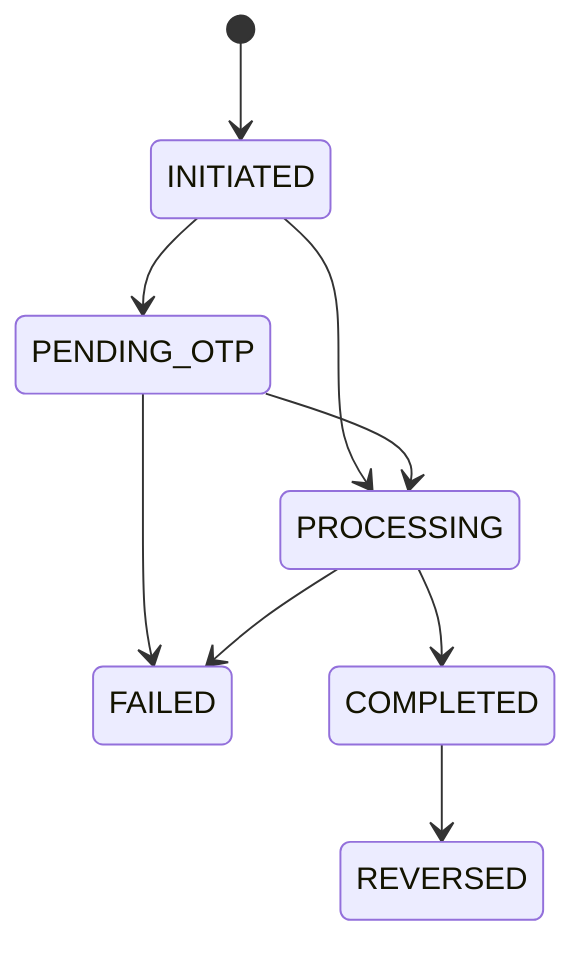

# Simple Banking App — Web Desktop

Ứng dụng ngân hàng trực tuyến chạy trên trình duyệt desktop, cho phép người dùng quản lý tài khoản, nạp/rút tiền, chuyển khoản nội bộ an toàn, tra cứu lịch sử giao dịch và hỗ trợ quản trị viên (`ADMIN`) quản lý người dùng, giám sát giao dịch toàn hệ thống, xem nhật ký kiểm toán và thực hiện hoàn tiền (`REVERSAL`). Dự án tuân thủ nguyên tắc K.I.S.S, đảm bảo tính toàn vẹn dữ liệu và bảo mật bằng Database Transaction, Pessimistic Locking (`SELECT ... FOR UPDATE`), chống Deadlock, bảng **`idempotency_keys`** (lưu mã băm SHA-256, bản chụp kết quả và hạn dùng 24h) kết hợp **Auto-Retry an toàn phía Frontend**, **Sổ cái kép chỉ-ghi-thêm (`ledger_entries`)**, **Vòng đời giao dịch (State Machine 3 Pha)**, **Phân quyền RBAC (`CUSTOMER` / `ADMIN`)** và **Nhật ký kiểm toán tự động chỉ-ghi-thêm (`audit_logs`)**.

## 1. Overview & Tech Stack
- **Backend:** NestJS, TypeScript, TypeORM (Migrations & Entity Subscribers), PostgreSQL, `@nestjs/schedule` (Cron quét giao dịch treo & dọn khóa Idempotency hết hạn), Node.js `AsyncLocalStorage`, Passport JWT, Bcrypt, Class-Validator, Swagger.
- **Frontend:** Next.js (App Router — Client Components), ReactJS, Zustand, Tailwind CSS, Axios (kèm cơ chế Idempotent Auto-Retry & `useRef` In-Flight Guard).
- **Infrastructure & Testing:** Docker, Docker Compose, Jest & Supertest (6 bộ E2E Test Suites với 43 bài kiểm thử tích hợp trên DB test tách biệt).

## 2. Architecture
Hệ thống phân tầng rõ ràng theo kiến trúc module của NestJS: `Middleware (AsyncLocalStorage) -> Guard (JwtAuthGuard, RolesGuard) -> Interceptor (AuditInterceptor) -> Controller -> Service -> TypeORM Repository / EntityManager / Subscriber -> PostgreSQL`.
- Sơ đồ tuần tự (Auth + Login Audit, Luồng giao dịch 3 Pha kèm Idempotency Snapshot, Hoàn tiền `REVERSAL`, và Khóa/Mở khóa User kèm Transactional Audit Subscriber): xem tại [`docs/sequence_diagrams.md`](docs/sequence_diagrams.md).
- Ghi chép quyết định kiến trúc (ADR-001 → ADR-015): xem tại [`docs/ADR.md`](docs/ADR.md).
- Báo cáo thực nghiệm Concurrency & Locking (Module 1):
  - [`docs/concurrency/1.1-race-condition.md`](docs/concurrency/1.1-race-condition.md) — Tái hiện lỗi Race Condition (Lost Update).
  - [`docs/concurrency/1.3-lock-comparison.md`](docs/concurrency/1.3-lock-comparison.md) — Benchmark so sánh Pessimistic Locking và Optimistic Locking.
  - [`docs/concurrency/1.4-deadlock.md`](docs/concurrency/1.4-deadlock.md) — Phòng ngừa & Xử lý Deadlock khi chuyển khoản hai chiều A↔B.

## 3. Environment Variables
Sao chép file môi trường mẫu trước khi chạy:
```bash
# Cho Docker Compose ở thư mục gốc
cp .env.example .env

# Cho phát triển local & chạy test trong thư mục backend
cp backend/.env.example backend/.env
cp backend/.env.test.example backend/.env.test
```

## 4. Chạy dự án bằng Docker (Khuyên dùng)
Chỉ cần một lệnh duy nhất từ thư mục gốc:
```bash
docker compose up --build
```
Khi khởi động, container `backend` sẽ tự động thực hiện tuần tự:
1. Chạy TypeORM Migrations (`npm run migration:run:prod` — tạo bảng, backfill sổ cái, gắn trigger bất biến cho `ledger_entries` và `audit_logs`, nâng cấp schema State Machine / Reversal, tạo bảng `idempotency_keys` và chuẩn hóa enum `users.role` sang `CUSTOMER | ADMIN`).
2. Chạy Seed dữ liệu mẫu nếu `SEED_ON_START=true` (tạo 1 `ADMIN`, 3 `CUSTOMER`, giao dịch mẫu và đồng bộ bút toán sổ cái mà không sinh bản ghi audit rác).
3. Khởi động NestJS API server ở cổng `3000`.

Các địa chỉ truy cập:
- **Frontend UI:** http://localhost:3001
- **Backend API:** http://localhost:3000/api
- **Swagger Docs:** http://localhost:3000/api/docs

## 5. Local Development & Quản lý Migration
Nếu muốn chạy Backend và Frontend trực tiếp trên máy host:
```bash
# 1. Khởi chạy PostgreSQL cho môi trường dev (cổng 5432)
docker compose up -d postgres

# 2. Chạy Migration & Seed tại thư mục backend
cd backend
npm install
npm run migration:run
npm run seed
npm run start:dev

# 3. Khởi chạy Frontend ở một cửa sổ terminal khác
cd frontend
npm install
npm run dev
```

Các lệnh quản lý schema với TypeORM Migration (trong thư mục `backend/`):
- Chạy migration mới nhất: `npm run migration:run`
- Hoàn tác (rollback) 1 migration gần nhất: `npm run migration:revert`
- Sinh migration mới khi sửa Entity: `npm run migration:generate -- src/database/migrations/<TenMigration>`

## 6. Chạy Kiểm thử Tự động (43 E2E Tests trên DB Test riêng)
Dự án bố trí container `postgres-test` chạy riêng ở cổng `5433` (sử dụng `tmpfs` trên RAM) để việc chạy test **không bao giờ chạm vào dữ liệu dev**:
```bash
# 1. Bật container database test (cổng 5433)
docker compose --profile test up -d postgres-test

# 2. Tạo file .env.test (nếu chưa có) và chạy toàn bộ E2E Test
cd backend
cp .env.test.example .env.test
npm run test:e2e
```
Bộ test bao gồm 6 test suites (43 bài kiểm thử tích hợp):
- `test/app.e2e-spec.ts` (1 test): Smoke test luồng Đăng ký → Đăng nhập → Xem số dư → Nạp tiền (`DEPOSIT` / `COMPLETED`).
- `test/concurrency.e2e-spec.ts` (3 tests — Bài 7.2 + Kiểm tra bất biến Q1′–Q5):
  - **T1:** 20 request rút `100,000đ` đồng thời trên số dư `1,000,000đ` (5 vòng) → luôn đúng `10 × 201 COMPLETED`, `10 × 422 FAILED`, số dư `0.00`.
  - **T2:** Chuyển khoản hai chiều A→B và B→A đồng thời (5 vòng) → không deadlock/500, bảo toàn tổng số dư `A + B`.
  - **T3:** 5 request đồng thời dùng chung 1 `Idempotency-Key` (5 vòng) → tất cả phản hồi trong `{201, 200, 202}`, chỉ tạo đúng 1 giao dịch `COMPLETED` và 2 bút toán trong DB.
- `test/ledger.e2e-spec.ts` (5 tests — Bài 3.1 & Bài 7.3):
  - **L1:** Chặn đứng mọi thao tác `UPDATE` và `DELETE` trên `ledger_entries` qua cả TypeORM Repository lẫn SQL thô nhờ Trigger bất biến.
  - **L2:** Số dư từ `GET /api/accounts/me` khớp tuyệt đối với tổng bút toán `CREDIT − DEBIT`.
  - **L3:** Mỗi loại giao dịch sinh đúng số bút toán (`DEPOSIT = 1 CREDIT`, `WITHDRAW = 1 DEBIT`, `TRANSFER = 1 DEBIT + 1 CREDIT`); replay không sinh thêm bút toán.
  - **R1 & R2:** Giả lập lỗi giữa chừng ở Pha B → Pha B rollback 100% số dư và bút toán (`0` bút toán mồ côi), Pha C ghi nhận phiếu `FAILED` (`INTERNAL_ERROR`) và đóng khóa `idempotency_keys` sang `FAILED (500)`.
- `test/state-machine-reversal.e2e-spec.ts` (10 tests — Bài 3.2 & Bài 5.3):
  - **ST & ST2:** Duyệt toàn bộ 36 cặp chuyển trạng thái `(from, to)`; chỉ 7 cạnh hợp lệ được phép, từ chối `FAILED → COMPLETED`.
  - **F1 & F2:** Ghi nhận `FAILED` kèm `failure_code` (`INSUFFICIENT_BALANCE`, `INTERNAL_ERROR`), có `0` bút toán, replay cùng key trả lại đúng bản chụp lỗi cũ.
  - **P1 & P2:** Replay giao dịch đang `PROCESSING` (khóa `IN_PROGRESS`) trả về `202 Accepted`; `sweepStuckTransactions()` đánh dấu `FAILED/TIMEOUT` cho phiếu `PROCESSING` cũ không có bút toán (và đóng luôn dòng khóa `idempotency_keys` sang `FAILED/503`), giữ nguyên phiếu mới và log `ERROR` nếu phiếu cũ đã có bút toán.
  - **V1 – V4:** Hoàn tiền thành công cho cả `TRANSFER`, `DEPOSIT`, `WITHDRAW`; chống hoàn tiền hai lần khi 5 request bắn đồng thời; xử lý bên nhận thiếu số dư (`422 REVERSAL_INSUFFICIENT_BALANCE`) và thử lại thành công sau khi nạp tiền; kiểm tra `RolesGuard` (`403`) và chặn hoàn tiền sai trạng thái (`409`).
- `test/idempotency.e2e-spec.ts` (10 tests — Bài 2.1):
  - **I1 – I10:** Kiểm chứng gửi lặp 5 lần tuần tự (`I1`), trùng khóa khác nội dung/khác loại thao tác trả `409` (`I2`), 5 request đồng thời cùng khóa (`I3`), replay lỗi `FAILED` (`I4`), khóa hết hạn xử lý như mới (`I5`), thiếu/sai UUID header trả `400` (`I6`), dọn dẹp `deleteExpiredKeys()` (`I7`), cô lập khóa theo `user_id` (`I8`), bảo toàn bản chụp `COMPLETED` ngay cả sau khi giao dịch bị `REVERSED` (`I9`), và đồng bộ khóa khi quét giao dịch treo (`I10`).
- `test/rbac-admin-audit.e2e-spec.ts` (14 tests — Bài 3.3 & Bài 4.1):
  - **RB1 – RB4:** Kiểm chứng `CUSTOMER` xem tài khoản người khác bị chặn `403`, xem tài khoản của mình được `200`, `ADMIN` xem mọi tài khoản (`200`/`404`); kiểm tra ma trận `401`/`403`; chứng minh đổi `role` bằng SQL có hiệu lực tức thì trên cùng JWT token cũ (`RB3`); và `ADMIN` bị `locked` cũng bị từ chối `403` ngay lập tức (`RB4`).
  - **AD1 – AD4:** Kiểm chứng phân trang, lọc `status`/`role` và không lộ `passwordHash` tại `/api/admin/users`; khóa/mở khóa user có hiệu lực tức thì; chặn tự khóa chính mình (`400`), không sinh audit thừa khi trạng thái không đổi; và lọc `/api/admin/transactions` dưới góc nhìn Admin (`fromAccountNumber`, `toAccountNumber`).
  - **AU1 – AU6:** Kiểm chứng khóa/mở khóa tự động ghi 2 bản ghi `USER_STATUS_CHANGED` có `beforeData`/`afterData`, `actor`, `ipAddress`, `userAgent` và thỏa mãn **Q6, Q7** (`AU1`, `AU2`); chặn sửa/xóa `audit_logs` bằng Trigger (`AU3`); phân quyền xem `/api/admin/audit-logs` (`AU4`); ghi nhận `AUTH_LOGIN_SUCCESS`, `AUTH_LOGIN_FAILED` (không nuốt lỗi, không lộ mật khẩu), `TRANSACTION_REVERSED` (`AU5`); và chứng minh rollback transaction cập nhật `User` cũng rollback 100% bản ghi audit của Subscriber (`AU6`).

## 7. Concurrency, Locking & Deadlock (Module 1)
1. **Chống Lost Update / Âm quỹ (Bài 1.1 & 1.2):** Khóa dòng tài khoản bằng `SELECT ... FOR UPDATE OF "account"` kết hợp `UPDATE ... WHERE balance >= :amount RETURNING balance` và `SET LOCAL lock_timeout = '5s'`.
2. **Phòng ngừa & Xử lý Deadlock (Bài 1.4):** Tải và khóa các tài khoản theo thứ tự cố định `ORDER BY account.id ASC`, kết hợp vòng lặp `executeWithDeadlockRetry` (tối đa 3 lần khi gặp mã `40P01`).
3. **Chạy Script bắn tải:**
   ```bash
   node scripts/concurrency/withdraw-load.mjs
   node scripts/concurrency/transfer-ab-ba.mjs
   ```

## 8. Sổ cái kép — Double-entry Ledger (Module 3A)
Mọi biến động số dư ở Pha B đều được ghi thành các bút toán bất biến trong bảng `ledger_entries` (`id BIGSERIAL`, `account_id`, `transaction_id`, `type DEBIT | CREDIT`, `amount > 0`, `balance_after >= 0` lấy từ `UPDATE ... RETURNING balance`) trong cùng một Database Transaction và được bảo vệ bởi Trigger `trg_ledger_entries_immutable`.

## 9. Vòng đời giao dịch (State Machine) & Hoàn tiền (`REVERSAL` — Module 3B)

### 9.1. Sơ đồ trạng thái & Bảng cạnh hợp lệ
Mọi thay đổi cột `status` trên bảng `transactions` bắt buộc phải đi qua hàm `transition()` với câu lệnh đóng dấu có điều kiện `UPDATE transactions SET status = :to, updated_at = now() WHERE id = :id AND status = :from`:



| Trạng thái hiện tại (`from`) | Các trạng thái kế tiếp hợp lệ (`to`) | Ghi chú |
| :--- | :--- | :--- |
| `INITIATED` | `PENDING_OTP`, `PROCESSING` | Trạng thái khởi tạo ngay khi lập phiếu ở Pha A |
| `PENDING_OTP` | `PROCESSING`, `FAILED` | Dành sẵn cho luồng xác thực OTP giao dịch lớn (Module 4.3) |
| `PROCESSING` | `COMPLETED`, `FAILED` | Đang xử lý ở Pha B (hoặc bị đánh dấu `FAILED` ở Pha C / Job quét treo) |
| `COMPLETED` | `REVERSED` | Giao dịch đã hoàn tất; chỉ đổi sang `REVERSED` khi hoàn tiền thành công |
| `FAILED` | *(Không đi đâu nữa)* | Trạng thái kết thúc (Terminal state) |
| `REVERSED` | *(Không đi đâu nữa)* | Trạng thái kết thúc (Terminal state) |

### 9.2. Luồng thực thi 3 Pha & Bảng mã lỗi (`FAILURE_CODE_MAP`)
- **Pha A (Tạo phiếu & Khóa):** Kiểm tra đầu vào (400/404), đăng ký khóa `idempotency_keys` (`IN_PROGRESS`) bằng `INSERT ... ON CONFLICT DO NOTHING` → `INSERT` phiếu `INITIATED` → `transition(INITIATED → PROCESSING)` → gắn `transaction_id` vào dòng khóa → `COMMIT`.
- **Pha B (Xử lý tiền, Sổ cái & Lưu Snapshot):** Khóa tài khoản `FOR UPDATE` → Kiểm tra nghiệp vụ & số dư → Trừ/cộng tiền (`RETURNING balance`) → Ghi bút toán `ledger_entries` → `transition(PROCESSING → COMPLETED)` → cập nhật `idempotency_keys` sang `COMPLETED` kèm bản chụp `response_body` (`201`) → `COMMIT`.
- **Pha C (Ghi nhận `FAILED`):** Khi Pha B lỗi và đã `ROLLBACK` hoàn toàn (số dư và sổ cái không đổi), mở transaction ngắn mới gọi `transition(PROCESSING → FAILED, { failureCode })` và cập nhật `idempotency_keys` sang `FAILED` kèm bản chụp lỗi → `COMMIT`.

| `failure_code` | HTTP Status | Thông báo lỗi trả về Client |
| :--- | :---: | :--- |
| `INSUFFICIENT_BALANCE` | `422` | Không đủ số dư khả dụng |
| `DESTINATION_UNAVAILABLE` | `422` | Tài khoản đích đang bị khóa, không thể nhận tiền |
| `AMOUNT_OVERFLOW` | `422` | Số dư tài khoản vượt quá giới hạn cho phép |
| `REVERSAL_INSUFFICIENT_BALANCE` | `422` | Tài khoản nhận không đủ số dư để thực hiện hoàn tiền |
| `SERVER_BUSY` | `503` | Hệ thống đang bận, vui lòng thử lại |
| `TIMEOUT` | `503` | Giao dịch bị quá thời gian xử lý, vui lòng thử lại |
| `INTERNAL_ERROR` | `500` | Lỗi hệ thống khi thực hiện giao dịch |

### 9.3. Hướng dẫn Hoàn tiền (`REVERSAL`) bằng `curl` / Node với quyền `ADMIN`
Chỉ tài khoản có `role = 'ADMIN'` (`admin@bank.local` / `Password@123`) mới được gọi `POST /api/transactions/:id/reverse`:
```bash
# 1. Đăng nhập tài khoản Admin để lấy JWT Token
ADMIN_TOKEN=$(curl -s -X POST http://localhost:3000/api/auth/login \
  -H "Content-Type: application/json" \
  -d '{"email":"admin@bank.local","password":"Password@123"}' | node -pe 'JSON.parse(fs.readFileSync(0,"utf8")).accessToken')

# 2. Lấy ID của 1 giao dịch COMPLETED gần nhất trong DB
TX_ID=$(docker compose exec -T postgres psql -U root -d simple_bank -t -A -c \
  "SELECT id FROM transactions WHERE status = 'COMPLETED' AND type = 'TRANSFER' ORDER BY created_at DESC LIMIT 1;")

# 3. Gọi API Hoàn tiền với Idempotency-Key mới
curl -i -X POST "http://localhost:3000/api/transactions/${TX_ID}/reverse" \
  -H "Authorization: Bearer ${ADMIN_TOKEN}" \
  -H "Idempotency-Key: $(node -pe 'require(\"crypto\").randomUUID()')" \
  -H "Content-Type: application/json" \
  -d '{"reason":"Hoan tien theo yeu cau tra soat"}'
```

### 9.4. Cách mô phỏng Giao dịch "Treo" (`PROCESSING`) bằng SQL để Demo Job Quét
Cron job `sweepStuckTransactions()` chạy tự động mỗi phút để đánh dấu `FAILED` (`TIMEOUT`) cho các giao dịch `PROCESSING` có `updated_at` cũ hơn 120 giây (chưa có bút toán sổ cái) và đóng luôn dòng khóa `idempotency_keys` tương ứng sang `FAILED (503)`:
```bash
# 1. Chèn 1 giao dịch giả lập bị treo ở PROCESSING từ 5 phút trước kèm dòng khóa IN_PROGRESS
docker compose exec postgres psql -U root -d simple_bank -c "
WITH inserted_tx AS (
  INSERT INTO transactions (
    id, actor_account_id, from_account_id, to_account_id,
    amount, type, status, description, created_at, updated_at
  )
  SELECT
    uuid_generate_v4(), id, id, NULL,
    50000.00, 'WITHDRAW', 'PROCESSING', 'Demo stuck transaction (5m ago)',
    NOW() - INTERVAL '5 minutes', NOW() - INTERVAL '5 minutes'
  FROM accounts WHERE account_number = '1000000001'
  RETURNING id, actor_account_id
)
INSERT INTO idempotency_keys (
  user_id, idempotency_key, request_hash, status, transaction_id, created_at, expired_at
)
SELECT
  a.user_id, uuid_generate_v4(), repeat('f', 64), 'IN_PROGRESS', it.id,
  NOW() - INTERVAL '5 minutes', NOW() + INTERVAL '19 hours'
FROM inserted_tx it
JOIN accounts a ON a.id = it.actor_account_id;
"

# 2. Đợi đến mốc phút tiếp theo (tối đa 60s), xem log quét của backend và kiểm tra trạng thái
docker compose logs --tail=15 backend
docker compose exec postgres psql -U root -d simple_bank -c "
SELECT t.id, t.type, t.status AS tx_status, t.failure_code, ik.status AS key_status, ik.response_status
FROM transactions t
LEFT JOIN idempotency_keys ik ON ik.transaction_id = t.id
WHERE t.description = 'Demo stuck transaction (5m ago)';
"
```

### 9.5. Bộ 5 Truy vấn Bất biến Sổ cái & Hoàn tiền (Q1′, Q2, Q3, Q4, Q5)
Tất cả 5 truy vấn dưới đây đều phải trả về **`(0 rows)`** (0 dòng sai lệch):

**Q1′ — Giao dịch chưa/không hoàn tất (`FAILED`, `PROCESSING`...) có 0 bút toán; giao dịch `COMPLETED`/`REVERSED` có đủ bút toán cân bằng; `REVERSAL` khớp số bút toán với giao dịch gốc:**
```bash
docker compose exec postgres psql -U root -d simple_bank -c "
SELECT t.id, t.type, t.status
FROM transactions t
LEFT JOIN ledger_entries le ON le.transaction_id = t.id
GROUP BY t.id, t.type, t.status, t.amount, t.original_transaction_id
HAVING CASE
  WHEN t.status NOT IN ('COMPLETED', 'REVERSED') THEN COUNT(le.id) <> 0
  WHEN t.type = 'TRANSFER' THEN
       COUNT(le.id) <> 2
    OR COALESCE(SUM(le.amount) FILTER (WHERE le.type = 'DEBIT'), 0)  <> t.amount
    OR COALESCE(SUM(le.amount) FILTER (WHERE le.type = 'CREDIT'), 0) <> t.amount
  WHEN t.type = 'DEPOSIT' THEN
       COUNT(le.id) <> 1
    OR COALESCE(SUM(le.amount) FILTER (WHERE le.type = 'CREDIT'), 0) <> t.amount
  WHEN t.type = 'WITHDRAW' THEN
       COUNT(le.id) <> 1
    OR COALESCE(SUM(le.amount) FILTER (WHERE le.type = 'DEBIT'), 0) <> t.amount
  WHEN t.type = 'REVERSAL' THEN
       COUNT(le.id) <> (SELECT COUNT(*) FROM ledger_entries o WHERE o.transaction_id = t.original_transaction_id)
END;
"
```

**Q2 — Số dư hiển thị (`accounts.balance`) khớp tuyệt đối với tổng bút toán của từng tài khoản:**
```bash
docker compose exec postgres psql -U root -d simple_bank -c "
SELECT a.account_number, a.balance,
       COALESCE(SUM(CASE le.type WHEN 'CREDIT' THEN le.amount ELSE -le.amount END), 0) AS computed
FROM accounts a
LEFT JOIN ledger_entries le ON le.account_id = a.id
GROUP BY a.id, a.account_number, a.balance
HAVING a.balance <> COALESCE(SUM(CASE le.type WHEN 'CREDIT' THEN le.amount ELSE -le.amount END), 0);
"
```

**Q3 — Cột `balance_after` của từng dòng khớp với số dư cộng dồn theo thứ tự `id`:**
```bash
docker compose exec postgres psql -U root -d simple_bank -c "
SELECT x.id, x.account_id, x.balance_after, x.running
FROM (
  SELECT le.id, le.account_id, le.balance_after,
         SUM(CASE le.type WHEN 'CREDIT' THEN le.amount ELSE -le.amount END)
           OVER (PARTITION BY le.account_id ORDER BY le.id) AS running
  FROM ledger_entries le
) x
WHERE x.balance_after <> x.running;
"
```

**Q4 — Mỗi cặp (giao dịch gốc, giao dịch hoàn tiền `COMPLETED`) triệt tiêu nhau (`net = 0`) trên từng tài khoản:**
```bash
docker compose exec postgres psql -U root -d simple_bank -c "
SELECT o.id AS original_id, le.account_id,
       SUM(CASE le.type WHEN 'CREDIT' THEN le.amount ELSE -le.amount END) AS net
FROM transactions o
JOIN transactions r ON r.original_transaction_id = o.id AND r.type = 'REVERSAL' AND r.status = 'COMPLETED'
JOIN ledger_entries le ON le.transaction_id IN (o.id, r.id)
GROUP BY o.id, le.account_id
HAVING SUM(CASE le.type WHEN 'CREDIT' THEN le.amount ELSE -le.amount END) <> 0;
"
```

**Q5 — Trạng thái `REVERSED` của giao dịch gốc và giao dịch `REVERSAL COMPLETED` nhất quán 1-1:**
```bash
docker compose exec postgres psql -U root -d simple_bank -c "
SELECT o.id FROM transactions o
WHERE o.status = 'REVERSED'
  AND (SELECT COUNT(*) FROM transactions r
       WHERE r.original_transaction_id = o.id AND r.type = 'REVERSAL' AND r.status = 'COMPLETED') <> 1
UNION ALL
SELECT r.id FROM transactions r
WHERE r.type = 'REVERSAL' AND r.status = 'COMPLETED'
  AND NOT EXISTS (SELECT 1 FROM transactions o WHERE o.id = r.original_transaction_id AND o.status = 'REVERSED');
"
```

## 10. Cơ chế Chống Trùng Lặp Giao Dịch (`idempotency_keys`) & Frontend Auto-Retry (Module 2)

### 10.1. Cấu trúc bảng `idempotency_keys` & Cách tính `request_hash` (Bài 2.1)
Hệ thống lưu khóa chống trùng trong bảng **`idempotency_keys`** (`UNIQUE (user_id, idempotency_key)`):
- **`request_hash` (`char(64)`):** Mã băm SHA-256 tính từ object JSON có **thứ tự trường cố định** sau khi đã chuẩn hóa `amount` về đúng 2 chữ số thập phân bằng xử lý chuỗi (`"50000"` → `"50000.00"`) và sanitize `description` / `reason`.
- **Bản chụp kết quả (`response_status` & `response_body`):** Lưu ngay trong cùng transaction Pha B (khi `COMPLETED`) hoặc Pha C (khi `FAILED`).
- **Hạn dùng (`expired_at` = `created_at + 24 giờ`):** Tự động dọn dẹp mỗi giờ qua `@Cron(CronExpression.EVERY_HOUR)` (`deleteExpiredKeys()`) đối với các khóa đã kết thúc (`status <> 'IN_PROGRESS'`).

### 10.2. Bảng quy tắc Replay thống nhất
| Tình huống khi gửi lại cùng `Idempotency-Key` (cùng `user_id`) | HTTP Status | Hành vi của Hệ thống |
| :--- | :---: | :--- |
| Thiếu hoặc sai định dạng UUID ở header `Idempotency-Key` | `400 Bad Request` | Từ chối ngay tại Controller |
| Khác `request_hash` (khác số tiền, người nhận, mô tả, hoặc khác loại giao dịch) | `409 Conflict` | Từ chối ngay, không tạo giao dịch |
| Khóa ở trạng thái `COMPLETED` (còn hạn) | `200 OK` | Trả về nguyên bản chụp `response_body` đã lưu lúc hoàn tất (kể cả nếu về sau giao dịch bị `REVERSED`) |
| Khóa ở trạng thái `FAILED` (còn hạn) | `422 / 503 / 500` | Trả lại đúng `response_status` & `response_body` lỗi đã lưu (không chạy lại) |
| Khóa ở trạng thái `IN_PROGRESS` | `202 Accepted` | Trả về trạng thái hiện tại của giao dịch tương ứng (`PROCESSING`) |
| Khóa đã hết hạn (`expired_at <= NOW()` và `<> 'IN_PROGRESS'`) | `201 Created` | Xóa dòng khóa cũ đã hết hạn và xử lý như một yêu cầu giao dịch mới |

### 10.3. Danh sách Kiểm thử Thủ công cho Frontend Auto-Retry (Bài 2.2)
Hàm dùng chung `submitIdempotentTransaction()` (`frontend/src/services/api.ts`) đặt `timeout = 10s`, tự động retry tối đa `MAX_RETRIES = 3` lần (`1s → 2s → 4s`) với **cùng `Idempotency-Key`** khi mất mạng/timeout hoặc nhận `202 Accepted`, kết hợp cờ `inFlightRef = useRef(false)` trên cả `/transfer` và `/cash`:
1. **Bấm liên tục 5 lần khi mạng chậm (Slow 3G):** Chỉ có **1 request** được gửi đi, lịch sử chỉ có **1 giao dịch mới**, số dư giảm đúng 1 lần.
2. **Mất mạng giữa chừng (Offline 2s rồi bật lại):** Giao diện hiển thị *"Đang thử lại (lần 1/3)..."*, tự động gửi lại bằng đúng key cũ và hoàn tất với **1 giao dịch duy nhất**.
3. **Server chậm hơn timeout 10s (`docker compose pause backend` → `unpause`):** Giao diện tự retry và báo thành công, chỉ có **1 giao dịch**.
4. **Hết số lần thử lại (`indeterminate`):** Giao diện hiện hộp cảnh báo màu vàng *"Chưa xác nhận được giao dịch..."* (giữ nguyên key); sau khi `unpause` và bấm xác nhận lại → nhận kết quả thành công, vẫn chỉ có **1 giao dịch**.
5. **Lỗi nghiệp vụ dừng ngay, không retry:** Rút vượt số dư báo lỗi `422` ngay lập tức, không chạy retry; lần bấm tiếp theo tự động dùng key mới.

## 11. Phân quyền theo Vai trò (RBAC) & Admin API (Module 4A — Bài 4.1)

### 11.1. Cơ chế RBAC & Ma trận Quyền
Hệ thống định nghĩa 2 vai trò chuẩn hóa chữ HOA trong `users.role`: **`CUSTOMER`** và **`ADMIN`**.
- **Đọc vai trò trực tiếp từ Database mỗi request:** JWT Access Token chỉ mang `{ sub: user.id }`. Ở mỗi request, `JwtStrategy.validate()` tải thực thể `User` từ PostgreSQL để kiểm tra `user.status === 'locked'` (`403`) và cung cấp `user.role` mới nhất cho `RolesGuard`. Nhờ vậy, khi Admin khóa tài khoản hoặc khi vai trò người dùng thay đổi trong DB, hiệu lực diễn ra **ngay lập tức** trên cả các token cũ chưa hết hạn.

| Endpoint | Không có Token | `CUSTOMER` (Active) | `ADMIN` (Active) | User bị `locked` |
| :--- | :---: | :---: | :---: | :---: |
| `GET /api/accounts/me`, `POST /api/transactions/transfer\|deposit\|withdraw`, `GET /api/transactions` | `401` | ✅ (Tài khoản của mình) | ✅ (Tài khoản của mình) | ❌ `403` |
| `GET /api/accounts/:accountNumber` | `401` | ✅ `200` (Của mình)<br>❌ `403` (Người khác) | ✅ `200` (Mọi tài khoản)<br>`404` (Không tồn tại) | ❌ `403` |
| `POST /api/transactions/:id/reverse` | `401` | ❌ `403` | ✅ `201 / 200 / 202` | ❌ `403` |
| `GET /api/admin/users`, `PATCH /api/admin/users/:id/status` | `401` | ❌ `403` | ✅ `200` | ❌ `403` |
| `GET /api/admin/transactions` | `401` | ❌ `403` | ✅ `200` | ❌ `403` |
| `GET /api/admin/audit-logs` | `401` | ❌ `403` | ✅ `200` | ❌ `403` |

### 11.2. Cách thử nghiệm RBAC & Admin API bằng `curl` / Node
```bash
# 1. Lấy token của Customer A (user1) và Admin
CUST_TOKEN=$(curl -s -X POST http://localhost:3000/api/auth/login \
  -H "Content-Type: application/json" \
  -d '{"email":"user1@bank.local","password":"Password@123"}' | node -pe 'JSON.parse(fs.readFileSync(0,"utf8")).accessToken')

ADMIN_TOKEN=$(curl -s -X POST http://localhost:3000/api/auth/login \
  -H "Content-Type: application/json" \
  -d '{"email":"admin@bank.local","password":"Password@123"}' | node -pe 'JSON.parse(fs.readFileSync(0,"utf8")).accessToken')

# 2. CUSTOMER xem tài khoản người khác (1000000002) -> Bị chặn 403 Forbidden
curl -i "http://localhost:3000/api/accounts/1000000002" -H "Authorization: Bearer ${CUST_TOKEN}"

# 3. ADMIN xem tài khoản của Customer B (1000000002) -> 200 OK
curl -i "http://localhost:3000/api/accounts/1000000002" -H "Authorization: Bearer ${ADMIN_TOKEN}"

# 4. ADMIN lấy danh sách người dùng và danh sách giao dịch toàn hệ thống
curl -s "http://localhost:3000/api/admin/users?page=1&limit=10" -H "Authorization: Bearer ${ADMIN_TOKEN}"
curl -s "http://localhost:3000/api/admin/transactions?page=1&limit=5" -H "Authorization: Bearer ${ADMIN_TOKEN}"
```

## 12. Nhật ký Kiểm toán Tự động (`audit_logs` — Module 4A Bài 3.3)

### 12.1. Cấu trúc bảng `audit_logs` & Hai cơ chế ghi tự động
Bảng `audit_logs` (`id BIGSERIAL`, `actor_id`, `action`, `entity`, `entity_id`, `ip_address`, `user_agent`, `before_data`, `after_data`, `created_at`) được bảo vệ chỉ-ghi-thêm bằng Trigger `trg_audit_logs_immutable`. Ngữ cảnh yêu cầu (`actorId`, `ipAddress`, `userAgent`) được truyền tự động qua `AsyncLocalStorage` (`RequestContextMiddleware`):

| Mã hành động (`action`) | Cơ chế tự động | `entity` / `entity_id` | Nội dung `before_data` & `after_data` |
| :--- | :--- | :--- | :--- |
| `USER_STATUS_CHANGED` | `UserAuditSubscriber` (cùng DB Transaction qua `event.manager`) | `users` / `user.id` | `before_data: {"status":"active"}` → `after_data: {"status":"locked"}` (hoặc ngược lại) |
| `USER_UPDATED` | `UserAuditSubscriber` (cùng DB Transaction qua `event.manager`) | `users` / `user.id` | Chỉ các trường thay đổi nằm trong danh sách trắng `['fullName', 'email', 'role', 'status']` |
| `AUTH_LOGIN_SUCCESS` | `AuditInterceptor` + `@Audit()` | `users` / `user.id` | `after_data: {"email":..., "role":..., "outcome":"SUCCESS", "httpStatus":200}` |
| `AUTH_LOGIN_FAILED` | `AuditInterceptor` + `@Audit()` | `users` / `null` | `actor_id = null`; `after_data: {"email":..., "reason":..., "outcome":"ERROR", "httpStatus":401\|403}` (không lưu mật khẩu) |
| `TRANSACTION_REVERSED` | `AuditInterceptor` + `@Audit()` | `transactions` / `originalTx.id` | `after_data: {"originalTransactionId":..., "reversalTransactionId":..., "outcome":..., "httpStatus":...}` |

### 12.2. Xem Audit Log qua API và Chạy 2 Truy vấn Kiểm toán Bất biến (Q6 & Q7)
```bash
# Xem 10 dòng nhật ký kiểm toán mới nhất qua API của Admin
curl -s "http://localhost:3000/api/admin/audit-logs?page=1&limit=10" \
  -H "Authorization: Bearer ${ADMIN_TOKEN}"
```

Hai câu truy vấn kiểm toán **Q6** và **Q7** dưới đây đều phải trả về **`(0 rows)`**:

**Q6 — Không có bản ghi audit nào chứa dữ liệu mật (`password`):**
```bash
docker compose exec postgres psql -U root -d simple_bank -c "
SELECT id, action FROM audit_logs
WHERE before_data::text ILIKE '%password%' OR after_data::text ILIKE '%password%';
"
```

**Q7 — Mỗi lần đổi trạng thái người dùng (`USER_STATUS_CHANGED`) có đủ ảnh trước/sau khác nhau:**
```bash
docker compose exec postgres psql -U root -d simple_bank -c "
SELECT id FROM audit_logs
WHERE action = 'USER_STATUS_CHANGED'
  AND (before_data IS NULL OR after_data IS NULL
       OR before_data->>'status' IS NOT DISTINCT FROM after_data->>'status');
"
```

## 13. Seed Data & Tài khoản Demo
Script seed (`npm run seed`) là **idempotent** (không sinh bản ghi audit rác), tạo sẵn 1 `ADMIN` và 3 `CUSTOMER` kèm lịch sử giao dịch và bút toán sổ cái khớp tuyệt đối Q1′–Q5:
- **System Admin (`ADMIN` / `active`):** `admin@bank.local` / `Password@123` — STK: `1000000000` — Số dư: `0.00 VND` (Dùng để gọi `/api/admin/*` và `POST /api/transactions/:id/reverse`).
- **Customer A (`CUSTOMER` / `active`):** `user1@bank.local` / `Password@123` — STK: `1000000001` — Số dư cuối: `5,000,000.00 VND`.
- **Customer B (`CUSTOMER` / `active`):** `user2@bank.local` / `Password@123` — STK: `1000000002` — Số dư cuối: `2,000,000.00 VND`.
- **Customer C (`CUSTOMER` / `locked`):** `user3@bank.local` / `Password@123` — STK: `1000000003` — Số dư cuối: `1,000,000.00 VND`.

## 14. API Endpoints
| Method | Endpoint | Quyền hạn | Mô tả |
| :--- | :--- | :---: | :--- |
| `POST` | `/api/auth/register` | Public | Đăng ký người dùng mới (`role = CUSTOMER`) + tạo 1 tài khoản VND (`balance = 0.00`) |
| `POST` | `/api/auth/login` | Public | Đăng nhập nhận JWT Access Token (tự động ghi Audit Log `AUTH_LOGIN_SUCCESS` / `FAILED`) |
| `GET` | `/api/accounts/me` | `CUSTOMER`, `ADMIN` | Xem thông tin và số dư tài khoản của chính mình |
| `GET` | `/api/accounts/:accountNumber` | `CUSTOMER` (của mình), `ADMIN` (tất cả) | Tra cứu tài khoản theo STK (`CUSTOMER` xem của người khác → `403`) |
| `POST` | `/api/transactions/deposit` | `CUSTOMER`, `ADMIN` | Nạp tiền vào tài khoản của bản thân (Header `Idempotency-Key`; trả `201/200/202`) |
| `POST` | `/api/transactions/withdraw` | `CUSTOMER`, `ADMIN` | Rút tiền từ tài khoản của bản thân (Header `Idempotency-Key`; trả `201/200/202`) |
| `POST` | `/api/transactions/transfer` | `CUSTOMER`, `ADMIN` | Chuyển khoản nội bộ tới số tài khoản khác (Header `Idempotency-Key`; trả `201/200/202`) |
| `POST` | `/api/transactions/:id/reverse` | Chỉ `ADMIN` | Hoàn tiền giao dịch `COMPLETED` bằng giao dịch `REVERSAL` mới (Header `Idempotency-Key`, có Audit Log) |
| `GET` | `/api/transactions` | `CUSTOMER`, `ADMIN` | Lịch sử giao dịch của bản thân (mọi trạng thái, kèm `originalTransactionId` & `reversalTransactionId`) |
| `GET` | `/api/admin/users` | Chỉ `ADMIN` | Danh sách người dùng kèm `accountNumber` (phân trang, lọc `status`/`role`, ẩn `password_hash`) |
| `PATCH` | `/api/admin/users/:id/status` | Chỉ `ADMIN` | Khóa / Mở khóa người dùng (`active` \| `locked`), hiệu lực tức thì & tự động ghi Audit Log cùng transaction |
| `GET` | `/api/admin/transactions` | Chỉ `ADMIN` | Xem toàn bộ giao dịch hệ thống (`fromAccountNumber`, `toAccountNumber`, lọc `status`, `type`, `accountNumber`, ngày) |
| `GET` | `/api/admin/audit-logs` | Chỉ `ADMIN` | Xem nhật ký kiểm toán hệ thống (phân trang, lọc `actorId`, `action`, `entity`, `entityId`, ngày) |

## 15. Demo Scenario
1. Chạy `docker compose up --build`, mở `http://localhost:3001`.
2. Đăng nhập `user1@bank.local` / `Password@123` → Dashboard hiển thị STK `1000000001` và số dư `5.000.000 VND`.
3. Mở **Nạp / Rút tiền** (`/cash`): nạp `200.000 VND`, rút `100.000 VND`; thử rút `99.000.000 VND` → báo lỗi `422` ngay lập tức (không retry) và xuất hiện dòng `FAILED` ("Thất bại") trong lịch sử; sửa lại số tiền rút hợp lệ → thành công ngay.
4. Mở **Chuyển khoản** (`/transfer`): chuyển `50.000 VND` tới `1000000002`.
5. Thực hiện hoàn tiền giao dịch vừa chuyển bằng lệnh `curl` với token của `admin@bank.local` (Mục 9.3) và thử khóa/mở khóa `user2` qua `/api/admin/users/:id/status` (Mục 11.2) → Gọi `/api/admin/audit-logs` (Mục 12.2) để xem các bản ghi `AUTH_LOGIN_SUCCESS`, `USER_STATUS_CHANGED` (với `beforeData`/`afterData`) và `TRANSACTION_REVERSED`.
6. Chạy 7 truy vấn bất biến Q1′–Q5 (Mục 9.5) + Q6–Q7 (Mục 12.2) và chạy `npm run test:e2e` (43 bài test) ở Mục 6.

## 16. Troubleshooting & Known Limitations
- **Giới hạn thời gian chờ khóa & Retry:** Các giao dịch chạm vào cùng một tài khoản xếp hàng chờ tối đa `LOCK_TIMEOUT = '5s'`, và tự động retry tối đa `MAX_DEADLOCK_RETRIES = 3` lần nếu gặp deadlock `40P01`.
- **Giới hạn của Bảng `idempotency_keys` & Frontend Retry (Module 2):**
  - Ngay sau lần chạy migration nâng cấp xóa cột `transactions.idempotency_key`, các khóa cũ trước thời điểm nâng cấp không được ghi nhớ lại (không backfill).
  - Mỗi `Idempotency-Key` có hạn dùng **24 giờ (`TTL = 24h`)**; phản hồi Replay trả về **bản chụp kết quả (`response_body` snapshot)** tại thời điểm yêu cầu đó hoàn tất (không phản ánh thay đổi trạng thái về sau như `REVERSED`).
  - Mã `202 Accepted` yêu cầu client chủ động hỏi lại bằng cùng `Idempotency-Key`; nếu hết `MAX_RETRIES = 3` lần thử lại ở Frontend mà vẫn mất mạng/timeout hoặc nhận `202`, kết quả ở trạng thái **"chưa xác định" (`indeterminate`)**.
- **Giới hạn của Phân quyền RBAC & Nhật ký Kiểm toán (Module 4A bản rút gọn):**
  - **Phạm vi rút gọn (`HOÃN`):** Chưa triển khai vai trò `TELLER`, nghiệp vụ giao dịch hộ khách tại quầy (`/staff/transactions/*`), hạn mức duyệt giao dịch viên, API đổi vai trò người dùng (đổi qua SQL/seed) và chưa làm giao diện Admin UI ở Frontend (sử dụng Swagger / `curl` với token `ADMIN`).
  - **Cơ chế Audit của Interceptor là best-effort:** Trong khi `UserAuditSubscriber` ghi nhật ký trong cùng một Database Transaction với thao tác sửa `User` (qua `event.manager`), các sự kiện cấp HTTP do `AuditInterceptor` ghi nhận (`AUTH_LOGIN_SUCCESS`, `AUTH_LOGIN_FAILED`, `TRANSACTION_REVERSED`) được ghi ngay sau khi handler xử lý xong (best-effort, không cùng transaction).
  - **`UPDATE` bằng biểu thức SQL không đi qua Subscriber:** Các câu lệnh cập nhật bằng biểu thức SQL qua `QueryBuilder` (như cập nhật số dư `accounts.balance` hoặc `transactions.status`) không kích hoạt `UserAuditSubscriber` (vì đã có Sổ cái kép `ledger_entries` và State Machine lưu vết chuyên biệt).
  - **Địa chỉ IP trong Docker & Tăng trưởng bảng `audit_logs`:** Hệ thống đọc `req.ip` trực tiếp (chưa bật `trust proxy` vì chưa đặt sau reverse proxy), nên khi gọi trong mạng Docker nội bộ, IP ghi nhận có thể là địa chỉ gateway của Docker. Các lần đăng nhập thất bại (`AUTH_LOGIN_FAILED`) đều được ghi lại nên bảng `audit_logs` sẽ tăng dần theo thời gian.
- **Giới hạn của Trigger bất biến trên `ledger_entries` và `audit_logs`:** Trigger mức dòng chặn `UPDATE`/`DELETE`, nhưng `superuser` vẫn có thể tắt trigger và `TRUNCATE` mức bảng không kích hoạt trigger mức dòng (dùng để dọn dữ liệu trên DB test). Ở môi trường production thực tế, cần `REVOKE UPDATE, DELETE, TRUNCATE ON ledger_entries, audit_logs` khỏi role DB của ứng dụng.
- **Các lỗi đầu vào trước khi có phiếu không được lưu:** Ba lỗi yêu cầu sai trước Pha A (`400 DTO sai`, `404 tài khoản đích không tồn tại`, `400 tự chuyển cho chính mình`) bị từ chối và rollback ngay ở Pha A nên không lưu bản ghi `FAILED` vào DB.
- **Giới hạn của các Job định kỳ (`@Cron`):** Các job `sweepStuckTransactions()` (mỗi phút) và `deleteExpiredKeys()` (mỗi giờ) được thiết kế cho cấu hình **một instance backend**.

## 17. Kế hoạch mở rộng (Trạng thái các Module Bổ sung)

| Bài tập bổ sung | Điểm gắn trong mã nguồn thực tế | Trạng thái |
| :--- | :--- | :--- |
| **1.1, 1.2, 1.3, 1.4** Race Condition, Locking & Deadlock | `transactions.service.ts` (`loadAccountsForTransaction`, `executeWithDeadlockRetry`), `scripts/concurrency/`, `docs/concurrency/` | ✅ **ĐÃ HOÀN THÀNH (Module 1)** |
| **7.2** Concurrency Integration Tests | `backend/test/concurrency.e2e-spec.ts`, `backend/test/helpers/e2e-test.helper.ts` | ✅ **ĐÃ HOÀN THÀNH (Module 1)** |
| **3.1** Sổ cái kép (`ledger_entries`) | `ledger-entry.entity.ts`, Migration `1710000002000`, `transactions.service.ts` (`insertLedgerEntries`), `seed.ts` | ✅ **ĐÃ HOÀN THÀNH (Module 3A)** |
| **7.3** Test Rollback khi lỗi giữa chừng | `backend/test/ledger.e2e-spec.ts` (`L1–L3`, `R1–R2`), `assertLedgerInvariants()` | ✅ **ĐÃ HOÀN THÀNH (Module 3A)** |
| **3.2, 5.3** Transaction State Machine, `REVERSAL`, Ghi log `FAILED` & Quét treo | Migration `1710000003000`, `transactions.constants.ts`, `transactions.service.ts` (`transition`, 3 Pha, `reverseTransaction`, `sweepStuckTransactions`), `state-machine-reversal.e2e-spec.ts` | ✅ **ĐÃ HOÀN THÀNH (Module 3B)** |
| **2.1, 2.2** Bảng `idempotency_keys`, Snapshot Replay, TTL 24h & Frontend Auto-Retry | Migration `1710000004000`, `idempotency-key.entity.ts`, `idempotency.service.ts`, `frontend/src/services/api.ts` (`submitIdempotentTransaction`), `idempotency.e2e-spec.ts` (`I1–I10`) | ✅ **ĐÃ HOÀN THÀNH (Module 2)** |
| **3.3, 4.1 (cơ bản)** RBAC (`CUSTOMER`/`ADMIN`), Admin APIs & Audit Log tự động (`audit_logs`) | Migration `1710000005000`, `audit-log.entity.ts`, `request-context.ts`, `user-audit.subscriber.ts`, `audit.interceptor.ts`, `admin/`, `rbac-admin-audit.e2e-spec.ts` (`RB1–RB4`, `AD1–AD4`, `AU1–AU6`) | ✅ **ĐÃ HOÀN THÀNH (Module 4A rút gọn)** |
| **4.1 (mở rộng)** Vai trò `TELLER`, `/staff/transactions/*` & Giao diện Admin UI | Mở rộng `UserRole`, `AdminModule` & Frontend | ⏸️ **HOÃN (`DEFERRED`)** |
| **3.4, 5.1, 5.2** Hạn mức ngày, Trạng thái tài khoản (`FROZEN`/`CLOSED`) & Soft Delete | `common/utils/date.util.ts`, `validateActorAccount()`, Migration mới | Sẵn sàng (Module 5) |
| **6.1, 6.2, 6.3** Đối soát tự động, Fraud Detection, Logging & Health | `@nestjs/schedule`, `ledger_entries`, `transactions.service.ts` | Sẵn sàng (Module 6) |
| **7.1** Unit Test & Coverage | `TransactionsService`, `IdempotencyService`, `AdminService`, `backend/test/` | Sẵn sàng (Module 7) |