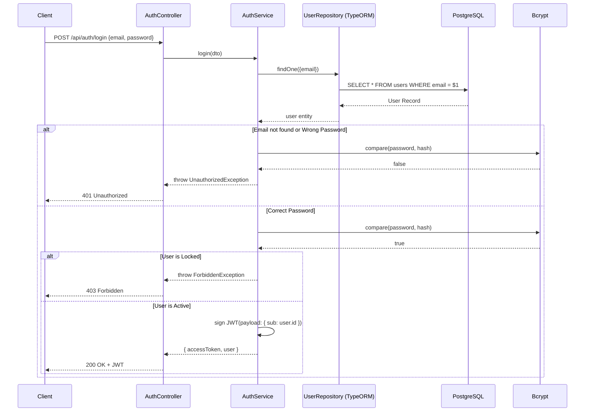
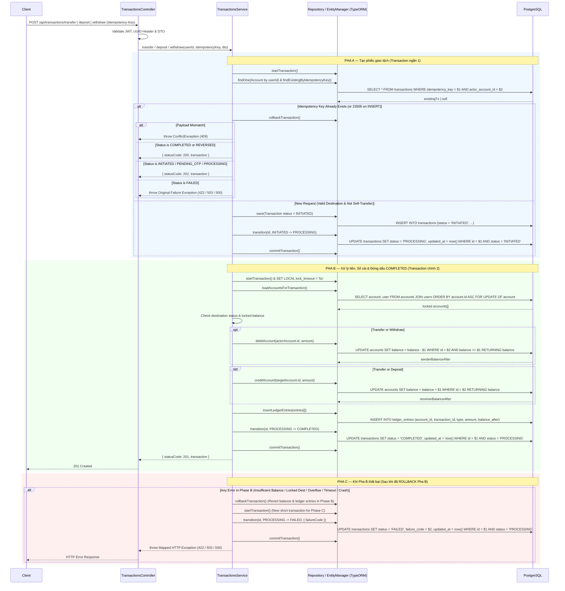
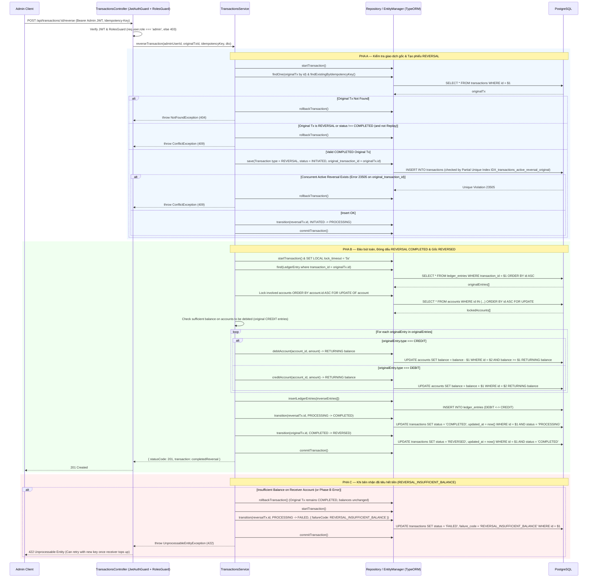

# Sequence Diagrams

## 1. Authentication Flow (Login)

## 2. Transaction & Double-Entry Ledger Flow — 3 Phases (Transfer / Deposit / Withdraw)

> **Ghi chú về Luồng 3 Pha (Pha A → Pha B → Pha C):**
> * **Pha A (Transaction ngắn 1):** Kiểm tra đầu vào (400/404), tra `Idempotency-Key` (nếu đã tồn tại: `COMPLETED/REVERSED -> 200`, `PROCESSING -> 202`, `FAILED -> lỗi cũ`, khác payload -> `409`), sau đó `INSERT` giao dịch ở trạng thái `INITIATED`, gọi `transition(INITIATED -> PROCESSING)` và `COMMIT` ngay.
> * **Pha B (Transaction chính 2 — có Deadlock Retry):** Khóa tài khoản bằng `SELECT ... FOR UPDATE OF "account"` theo `ORDER BY account.id ASC`, kiểm tra nghiệp vụ/số dư, trừ/cộng tiền (`RETURNING balance`), chèn bút toán `ledger_entries` và gọi `transition(PROCESSING -> COMPLETED)` trong **cùng một transaction** trước khi `COMMIT`.
> * **Pha C (Transaction ngắn 3 — khi Pha B lỗi):** Sau khi Pha B đã `ROLLBACK` hoàn toàn (số dư và sổ cái không đổi), mở transaction mới gọi `transition(PROCESSING -> FAILED, { failureCode })` rồi `COMMIT` và trả lỗi HTTP tương ứng cho client.

## 3. Transaction Reversal Flow (Admin Only — `POST /api/transactions/:id/reverse`)

