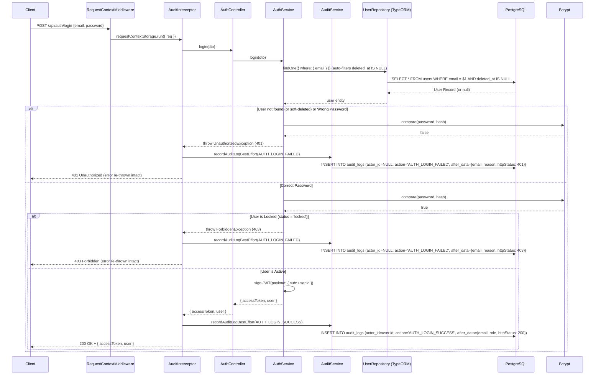
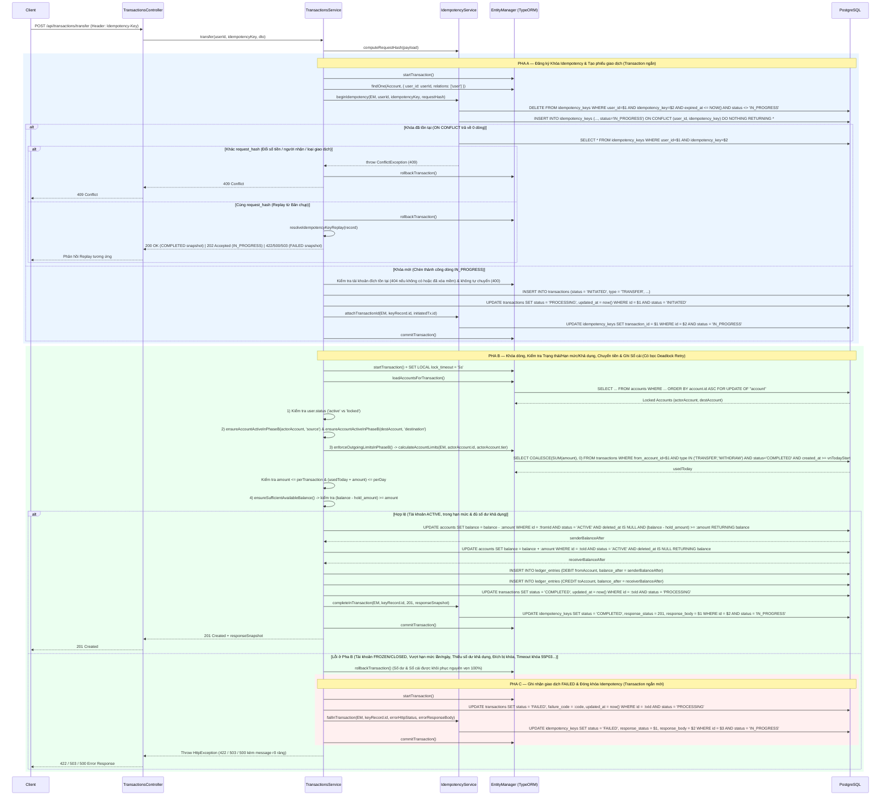
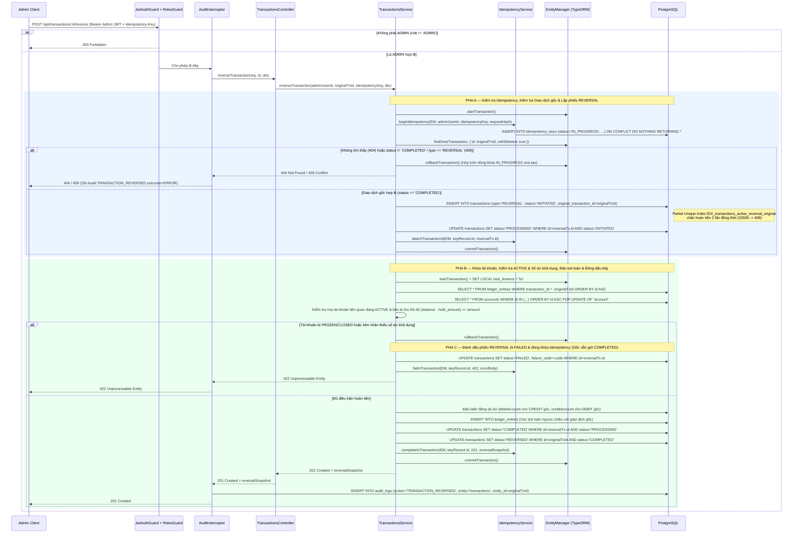
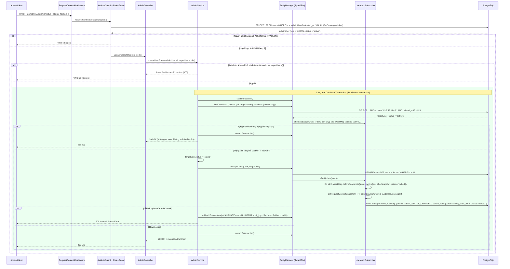
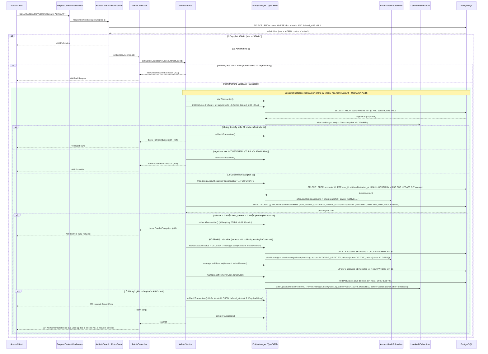

# Sequence Diagrams

Tài liệu này mô tả chi tiết luồng tương tác tuần tự giữa các tầng kiến trúc (`Client -> Middleware -> Guard -> Interceptor -> Controller -> Service -> TypeORM EntityManager / Subscriber -> PostgreSQL`) cho 5 nghiệp vụ cốt lõi của hệ thống.

---

## 1. Authentication Flow (Login + Automated Audit Interceptor)

---

## 2. 3-Phase Transaction Flow with Account Status, Daily Limits, Available Balance & Idempotency Snapshot (`TRANSFER` / `DEPOSIT` / `WITHDRAW`)

---

## 3. Transaction Reversal Flow (`POST /api/transactions/:id/reverse` — Admin Only + Audit)

---

## 4. Admin Lock/Unlock User Flow with Transactional Audit Subscriber (`PATCH /api/admin/users/:id/status`)

---

## 5. Admin Soft Delete User & Close Account Flow (`DELETE /api/admin/users/:id`)

