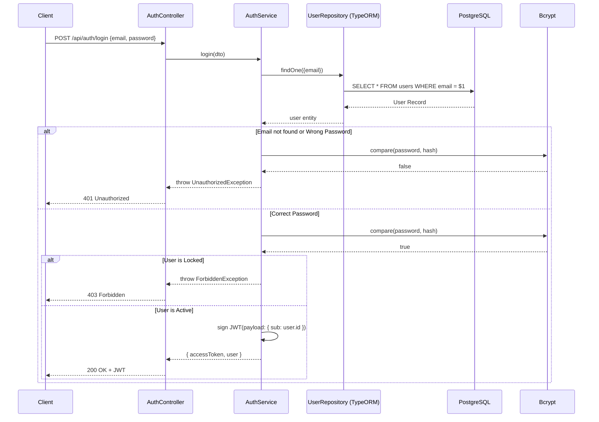
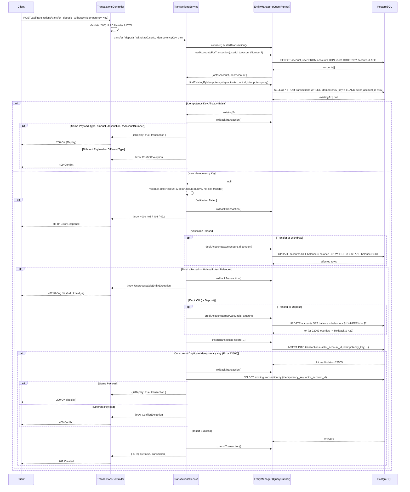

# Sequence Diagrams

## 1. Authentication Flow (Login)

## 2. Transaction Flow (Transfer / Deposit / Withdraw)

> **Ghi chú cho Nạp tiền (`deposit`) và Rút tiền (`withdraw`):**
> * Cả 3 nghiệp vụ (`transfer`, `deposit`, `withdraw`) đều đi qua cùng một cấu trúc bước xử lý trong `TransactionsService`[cite: 9].
> * Với `deposit`: chỉ tải `actorAccount` (`to_account_id = actorAccount.id`, `from_account_id = NULL`), bỏ qua bước `debitAccount` và chỉ thực hiện `creditAccount` (kèm bắt lỗi tràn số `22003` → `422`).
> * Với `withdraw`: chỉ tải `actorAccount` (`from_account_id = actorAccount.id`, `to_account_id = NULL`), chỉ thực hiện `debitAccount` có điều kiện `balance >= :amount` và bỏ qua `creditAccount`[cite: 9].

