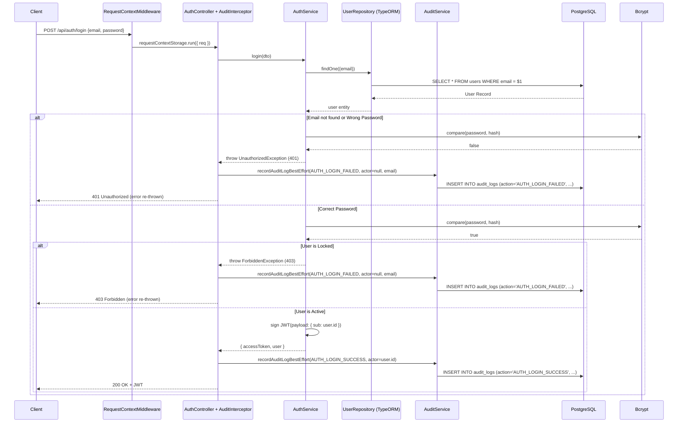
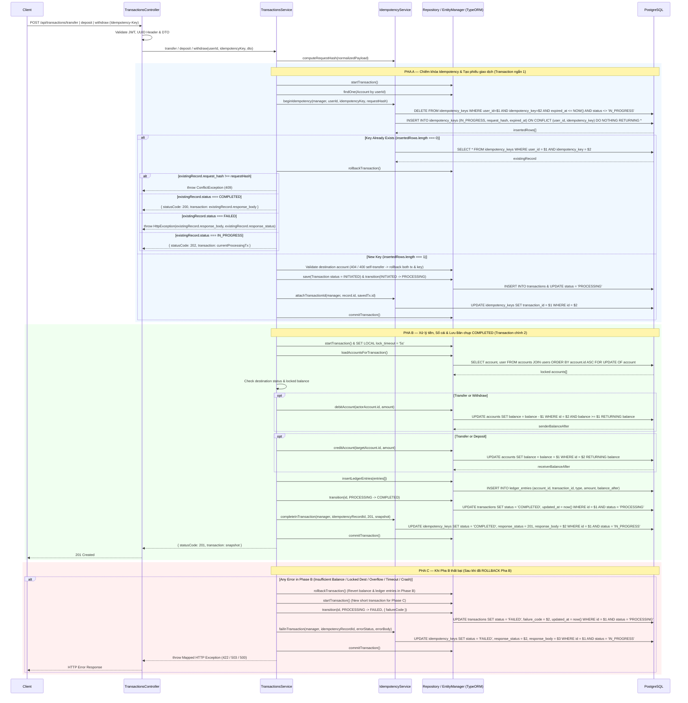
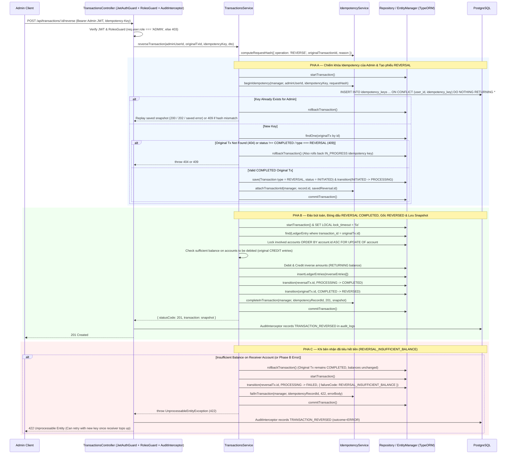
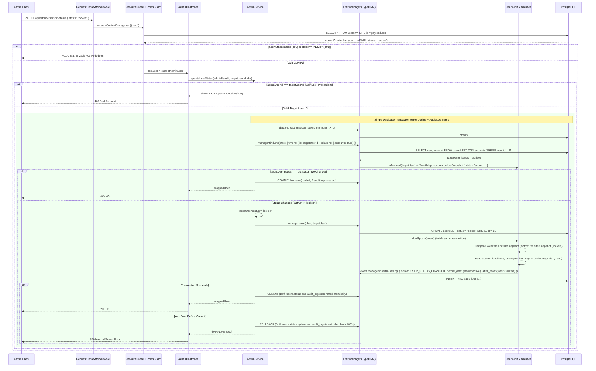

# Sequence Diagrams

## 1. Authentication Flow & Login Audit (`POST /api/auth/login`)

## 2. Transaction, Idempotency Snapshot & Double-Entry Ledger Flow — 3 Phases (Transfer / Deposit / Withdraw)

> **Ghi chú về Luồng 3 Pha kết hợp Bảng `idempotency_keys` (Module 2 + 3A + 3B):**
> * **Pha A (Transaction ngắn 1):** Kiểm tra đầu vào, chuẩn hóa dữ liệu và băm SHA-256 (`request_hash`), xóa dòng khóa cũ đã hết hạn (`expired_at <= NOW() AND status <> 'IN_PROGRESS'`), rồi chạy `INSERT INTO idempotency_keys (status = 'IN_PROGRESS', ...) ON CONFLICT (user_id, idempotency_key) DO NOTHING RETURNING *`.
>   * Nếu **không chèn được** (khóa đã tồn tại): đọc dòng khóa cũ ngay trong transaction → nếu khác `request_hash` trả `409`; nếu `COMPLETED` trả `200 OK` kèm bản chụp `response_body`; nếu `FAILED` trả lại đúng lỗi đã lưu; nếu `IN_PROGRESS` trả `202 Accepted`.
>   * Nếu **chèn được** (khóa mới): kiểm tra tài khoản đích (`404`/`400`), tạo phiếu `Transaction` (`INITIATED → PROCESSING`), gắn `transaction_id` vào dòng khóa và `COMMIT`.
> * **Pha B (Transaction chính 2 — có Deadlock Retry):** Khóa tài khoản bằng `SELECT ... FOR UPDATE OF "account"` theo `ORDER BY account.id ASC`, trừ/cộng tiền (`RETURNING balance`), chèn bút toán `ledger_entries`, đóng dấu giao dịch `PROCESSING → COMPLETED`, và gọi `completeInTransaction()` chuyển dòng `idempotency_keys` sang `COMPLETED` kèm bản chụp `response_body` (`201`) trong **cùng một transaction** trước khi `COMMIT`.
> * **Pha C (Transaction ngắn 3 — khi Pha B lỗi):** Sau khi Pha B đã `ROLLBACK` hoàn toàn (số dư và sổ cái không đổi), mở transaction mới đóng dấu giao dịch `PROCESSING → FAILED` (`failure_code`) và đóng dấu dòng `idempotency_keys` sang `FAILED` kèm bản chụp lỗi trước khi `COMMIT`.

## 3. Transaction Reversal Flow (Admin Only — `POST /api/transactions/:id/reverse`)

## 4. Admin Lock/Unlock User & Transactional Audit Subscriber Flow (`PATCH /api/admin/users/:id/status`)

