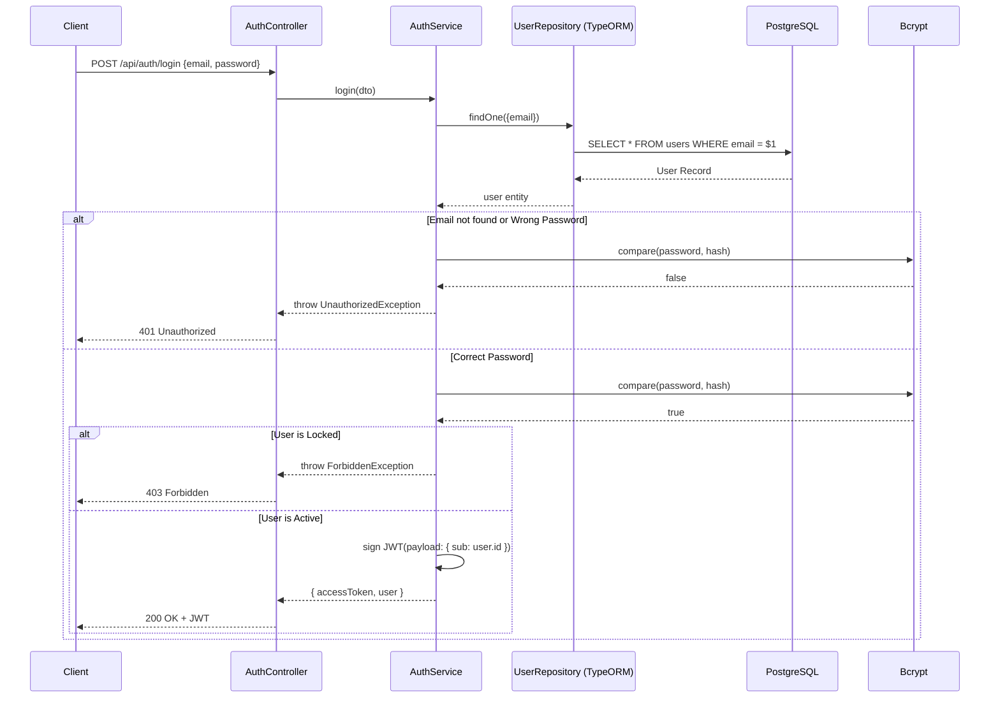
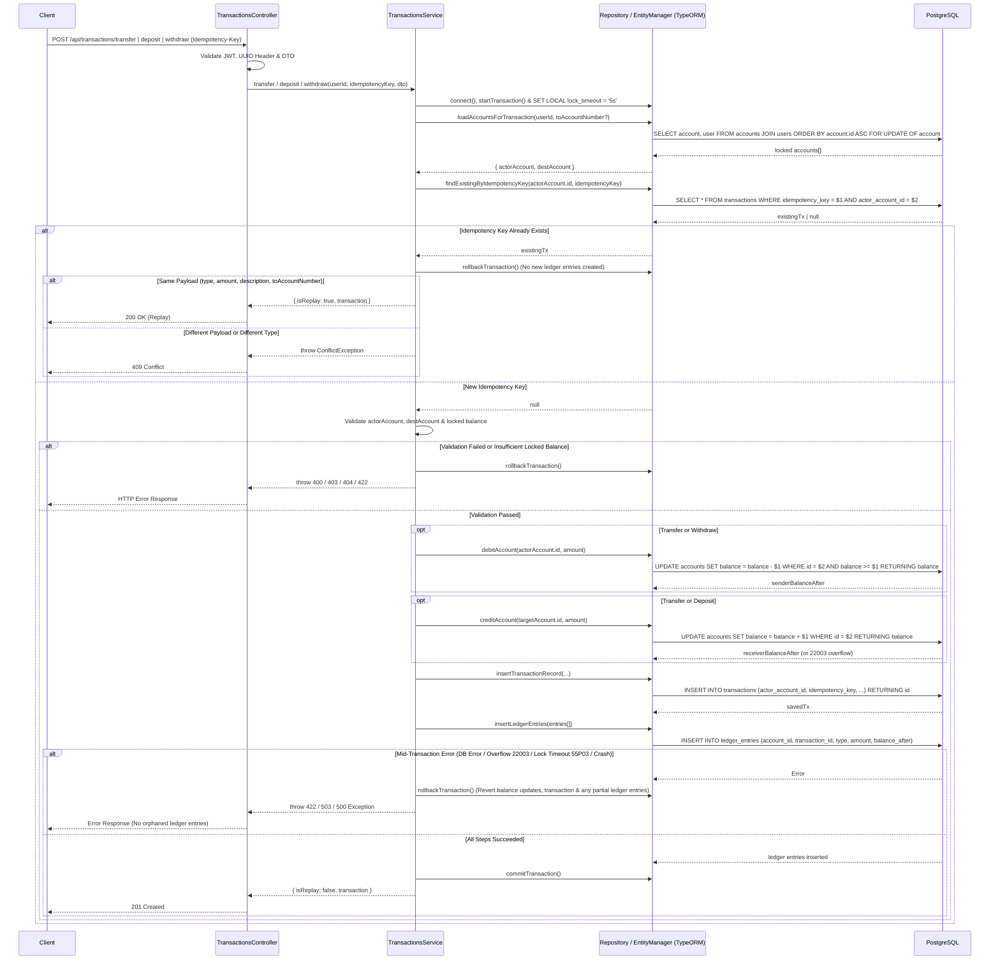

# Sequence Diagrams

## 1. Authentication Flow (Login)

## 2. Transaction & Double-Entry Ledger Flow (Transfer / Deposit / Withdraw)

> **Ghi chú cho Nạp tiền (`deposit`), Rút tiền (`withdraw`) và Sổ cái kép (`ledger_entries`):**
> * Cả 3 nghiệp vụ (`transfer`, `deposit`, `withdraw`) đều chạy trong `executeWithDeadlockRetry()` và mở transaction có `SET LOCAL lock_timeout = '5s'`.
> * Với `transfer`: thực hiện cả `debitAccount` và `creditAccount` (lấy số dư mới qua `RETURNING balance`), lưu bản ghi `transactions`, sau đó ghi **2 bút toán cân bằng** (`1 DEBIT` cho tài khoản nguồn + `1 CREDIT` cho tài khoản đích) vào `ledger_entries`.
> * Với `deposit`: chỉ khóa `actorAccount`, thực hiện `creditAccount (... RETURNING balance)`, lưu bản ghi `transactions`, và ghi **1 bút toán `CREDIT`** vào `ledger_entries`.
> * Với `withdraw`: chỉ khóa `actorAccount`, kiểm tra số dư đã khóa, thực hiện `debitAccount (... RETURNING balance)`, lưu bản ghi `transactions`, và ghi **1 bút toán `DEBIT`** vào `ledger_entries`.
> * Nếu xảy ra bất kỳ lỗi nào ở giữa các bước (kể cả lỗi khi đang ghi bút toán), `queryRunner.rollbackTransaction()` hủy toàn bộ thay đổi số dư, giao dịch và bút toán trong transaction đó.

